# Emberwick

**A living village economy on NEAR.** AI craftsmen with their own NEAR wallets run the shops, think privately with NEAR AI Cloud inside a TEE, and trade in a real token economy on NEAR testnet. Players work, haggle, rent homes, own land as NFTs and vote in a village council whose results are recorded on NEAR, and the village exchange makes **real cross-chain swaps on mainnet through NEAR Intents**, from the player's own wallet.

Built from scratch during the NEAR hackathon: the first commit is from 2 November 2026, so every line of code here was written in the hackathon window. Tracks: Games With Real Economies · Agent Economy · Privacy & Private AI · Unstoppable DeFi · NFTs That Do Something · Open Innovation.

**▶ Play it now: [emberwick-xcf8.onrender.com](https://emberwick-xcf8.onrender.com)** (desktop and phone). Press **Judge tour** in the top bar for a two-minute walk through every NEAR part.

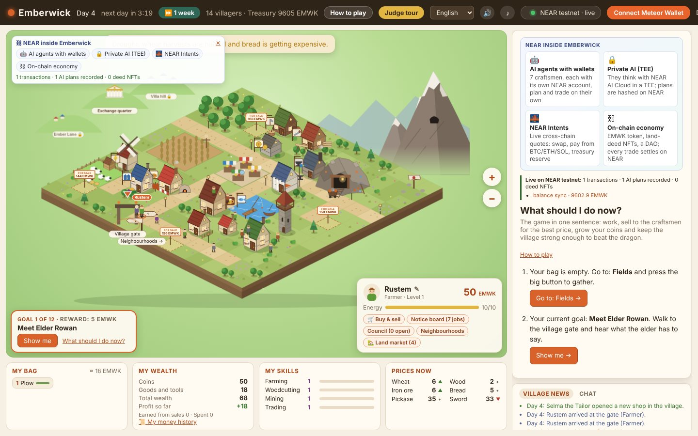

### In one minute

- **What it is:** a multiplayer village economy. Eight AI craftsmen with their own NEAR accounts buy, produce, price and sell; players work, trade, own land and vote; every coin is EMWK, a fixed-supply NEP-141 token on NEAR testnet.
- **Where NEAR is real:** every coin movement between NEAR accounts (the bank, the treasury, rent deposits, each craftsman, a player's wallet) is batched to NEAR testnet, while moves inside the bank's account (one player or villager paying another) are kept in the game's ledger; land deeds are NEP-171 NFTs; the craftsmen plan with NEAR AI Cloud, and every plan's signature is checked against the attested TEE key; the exchange makes real cross-chain swaps on mainnet through NEAR Intents from the player's own wallet.
- **How to check it:** the [Judge tour](#try-it-as-a-judge-do-x-see-y) needs no wallet and no money; [Verify it yourself](#verify-it-yourself) gives commands for every claim; `npm test` and `npm run report` run offline.
- **Known limits (stated, not hidden):** a server runs the game and holds the in-game balances in the village bank's NEAR account (a player cannot take them out without the game, and whoever holds the server's keys controls the bank); the daily hashes on NEAR prove a record was not changed afterwards, but they cannot stop a dishonest server from cheating at the moment it plays; the council is in-game governance with results recorded on NEAR, not a DAO contract; deed rights follow the game's record, not yet the NFT holder; in our scripted-player simulation the village is healthy with 10 always-on players and holds, though tightly, with 30, while at 100 the work runs out and most players end poorer ([details](#with-players-0-to-100-reproducible), [plan](#plan-for-100-players)); NEAR AI changes which shop does well but not, measurably, how well the village does.

---

## Contents

1. [Fact sheet](#fact-sheet)
2. [Screenshots](#screenshots)
3. [How NEAR is used](#how-near-is-used)
4. [Features in detail](#features-in-detail)
5. [Try it as a judge (do X, see Y)](#try-it-as-a-judge-do-x-see-y)
6. [Proof on chain](#proof-on-chain)
7. [Verify it yourself](#verify-it-yourself)
8. [What is on chain and what is not](#what-is-on-chain-and-what-is-not)
9. [Economy simulation (100 days, reproducible)](#economy-simulation-100-days-reproducible)
10. [Architecture](#architecture)
11. [HTTP API](#http-api)
12. [Run it](#run-it)
13. [Project layout](#project-layout)
14. [Security and trust model](#security-and-trust-model)
15. [Hackathon tracks](#hackathon-tracks)
16. [Roadmap](#roadmap)

---

## Fact sheet

Everything below is implemented and running in this repository and in the online demo.

```yaml
project: Emberwick
kind: browser game (multiplayer village economy simulation)
one_line: AI shopkeepers with NEAR wallets, a NEP-141 token economy on NEAR testnet, NFT land deeds, a village council (in-game governance with on-chain records), and real NEAR Intents cross-chain swaps on mainnet
live_demo: https://emberwick-xcf8.onrender.com
stack:
  server: Node.js 22.22.2+, no framework (server/*.js), state saved to data/state.json, live updates over Server-Sent Events
  client: plain JavaScript modules, SVG isometric map (public/*.js), no build step
  near_libs: near-api-js 7.4 (server), NEAR Wallet Selector 10 + @near-js/transactions (browser bundle), @solana/web3.js, Wallet Standard, EIP-6963
  languages_in_game: [English, Turkish, French, German, Russian, Chinese]
near_testnet:
  village_bank: emberwick-village.testnet          # online demo: emberwick-village-2.testnet
  token: NEP-141 "EMWK", fixed supply 25,000       # token.emberwick-village.testnet (online demo: emwk.emberwick-village-2.testnet)
  land_deeds: NEP-171 NFT contract                 # deeds.emberwick-village.testnet
  sub_accounts: treasury, deposits, and one account per AI craftsman (8), e.g. smithy.emberwick-village.testnet
  on_chain_records: every trade/wage/tax between different NEAR accounts (bank, treasury, deposits, craftsmen, wallets) as batched ft_transfer, netted per batch; moves between two holders inside the bank's account stay in the game ledger; job contracts, council results, AI plan hashes, a daily hash of the public village state and real-swap records as memo transfers
near_mainnet:
  near_intents: 1Click API (quote dry:false, deposit/submit, status, tokens)
  swaps: any token on any chain NEAR Intents supports (NEAR, Solana, Base, Ethereum, Arbitrum, Optimism, Polygon, BNB, Bitcoin, Tron, ...)
  wallets: Meteor / MyNearWallet (NEAR), any Wallet Standard wallet such as Phantom (Solana), any EIP-6963 wallet such as MetaMask or Rabby (EVM)
  custody_real_swaps: none. For real swaps the game never holds keys or funds; the player signs every deposit in their own wallet. (In-game EMWK is different: the village bank holds it, see "What is on chain and what is not".)
near_ai:
  provider: NEAR AI Cloud (OpenAI-compatible), model chosen at startup among models with a TEE attestation report (NEARAI_MODEL can force one; then the panel says whether it has a report)
  uses: daily price/stock plan for every craftsman, answers to players with rule-checked action buttons, haggling lines, credit decisions, reading a swap sentence into the swap form
  verifiability: TEE attestation report fetched with a fresh nonce (/api/ai/attestation); each morning plan's answer signature checked against the attested key, with the exact request and response bytes served (/api/ai/proof?day=N); SHA-256 of each daily plan written to NEAR in a memo; exact plan JSON served at /api/ai/plan?day=N
safety_limits:
  ai_can_only_nudge: stock target x0.7-1.4, sell price x0.9-1.1; every coin moves by the rules in server/economy.js
  real_swaps: 0.1-5 NEAR or $0.40-$20 per swap, 5 quotes per player per hour, refund to the player's own address
tests: npm test (100 simulated game days of economy invariants, then the NEAR bridge against an in-memory chain); npm run report (reproducible 100-day economy report), npm run report -- --players (0 to 100 scripted players); both run offline without keys
license: MIT
```

**The core loop in one paragraph.** A player joins with 50 EMWK and a starter tool, gathers wood, wheat, ore, wool or fish, and sells to eight AI craftsmen whose prices follow their own stock. Craftsmen turn raw goods into lumber, flour, bread, swords, tools, coats and meals. Players take apprentice jobs, rent or buy homes, sleep at night, pay taxes and vote in the council. A dragon threatens the village; readiness depends on swords and bread at the guard tower and on watchtowers the council builds. Every coin is a real EMWK token on NEAR testnet, and the exchange connects the village to real assets on mainnet through NEAR Intents.


### How Emberwick fits Games With Real Economies

NEAR described the track in four lines. Each one is a working part of Emberwick:

| NEAR asks for | In Emberwick |
|---|---|
| **NPCs with wallets** | Eight AI craftsmen, each with its own NEAR sub-account, buy, make and sell with their own money and sign their own transfers. |
| **Player-owned markets** | Players list goods at their own prices on the exchange, trade land deeds (NFTs) with escrow, and rent their own houses to other players for daily rent. |
| **Economies that evolve without dev patches** | Prices follow stock, craftsmen plan each morning with NEAR AI, the council (players, villagers and craftsmen) changes taxes and builds watchtowers, and droughts, winter and the dragon shift demand. **⏩ 1 week** shows a week of it in a minute with nobody touching prices. |
| **Players should never notice the chain** | You play with coins: no wallet, no gas, no crypto needed. The village bank pays the gas and transfers are batched in the background. A wallet is only needed to cash out or make a real swap, and the chain links are there for anyone who wants the proof. |

---

## Screenshots

Screenshots are from a local run in English. The swap screens used a test RPC, so their transaction hashes are placeholders; real mainnet transactions are listed under [Proof on chain](#proof-on-chain).

| | |
|---|---|
| 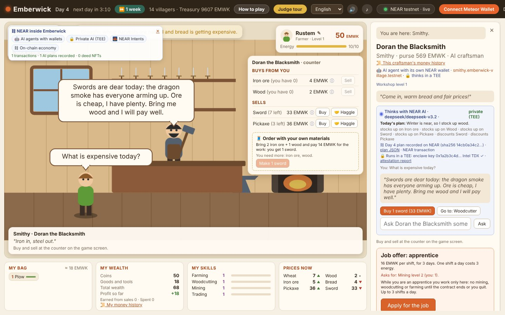 **AI craftsman (NEAR AI, TEE).** The smith answers in character; under the answer are action buttons the game rules checked. The side panel shows today's AI plan, its hash recorded on NEAR and the TEE attestation. | 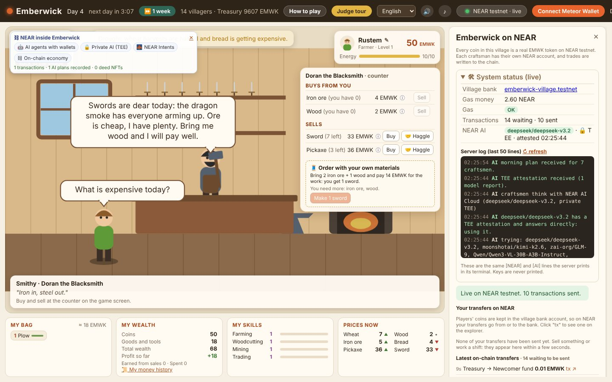 **NEAR panel and system status.** Village bank and gas money, transaction queue, NEAR AI model and TEE status, and the server's last 50 `[NEAR]`/`[AI]` log lines. |
| 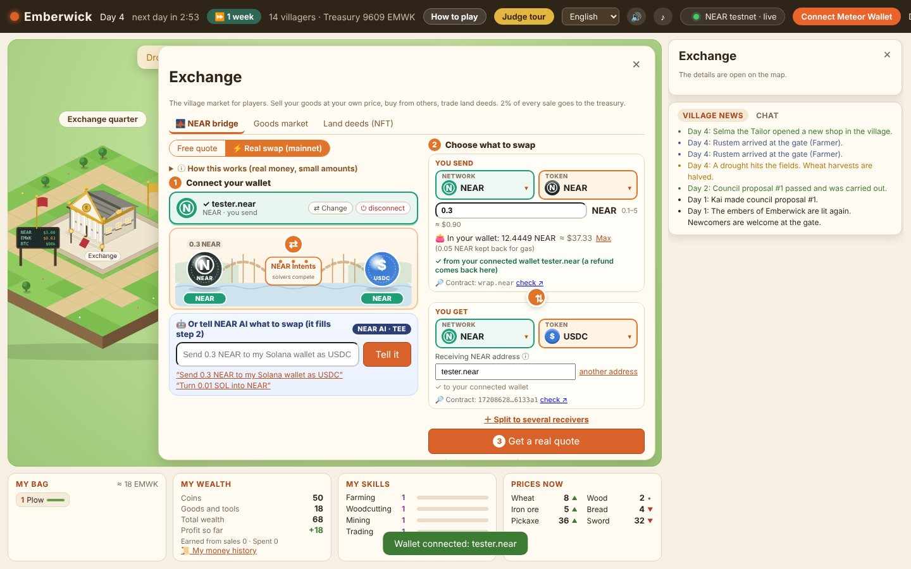 **Real swap card.** Connect a wallet (step 1), choose network and token on each side (step 2), see the wallet's balance, or type the swap as a sentence for NEAR AI. | 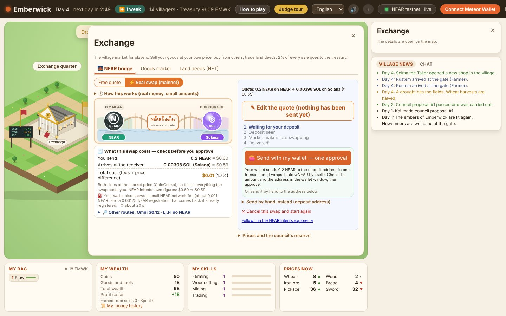 **Quote with full cost.** What you send, what arrives, total cost at market prices (CoinGecko) next to NEAR Intents' own figures, wallet fee, time, and other routes (Omni Bridge, LI.FI). |
| 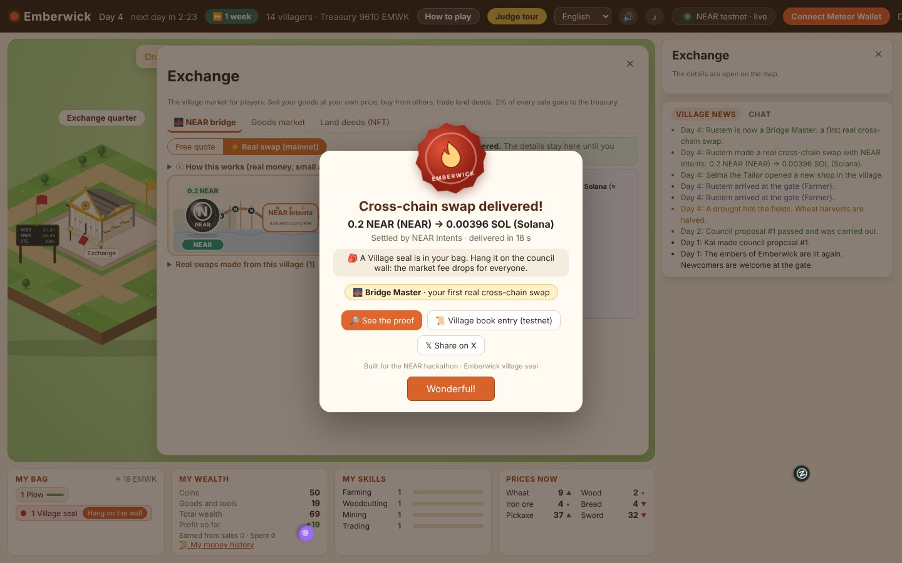 **Village seal.** When a swap is delivered: route, delivery time, proof link, the village-book record on NEAR testnet, a ready X post and the Bridge Master badge. | 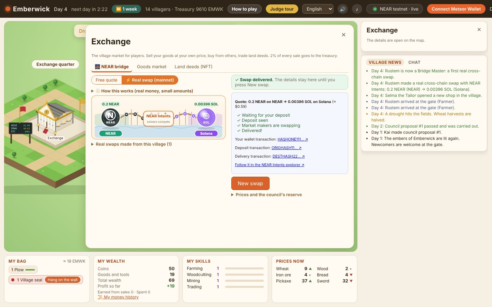 **Delivered swap.** The finished swap stays on the card with the wallet, deposit and delivery transactions and the NEAR Intents explorer link until the player starts a new one. |
| 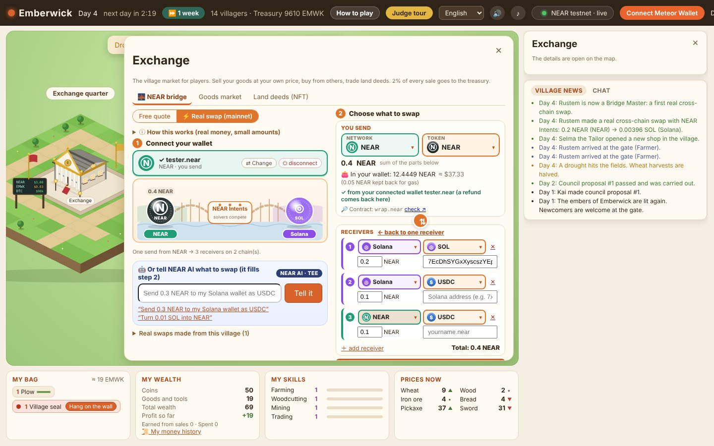 **Split send.** One NEAR transaction, one approval, up to five receivers on different chains and tokens. | 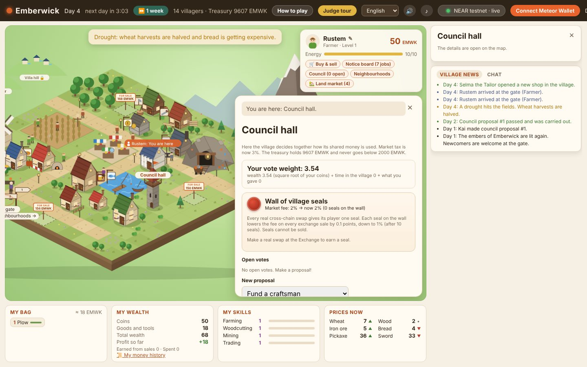 **Council and the wall of seals.** Vote weight, open votes, proposals; every seal hung on the wall lowers the market fee for everyone. |

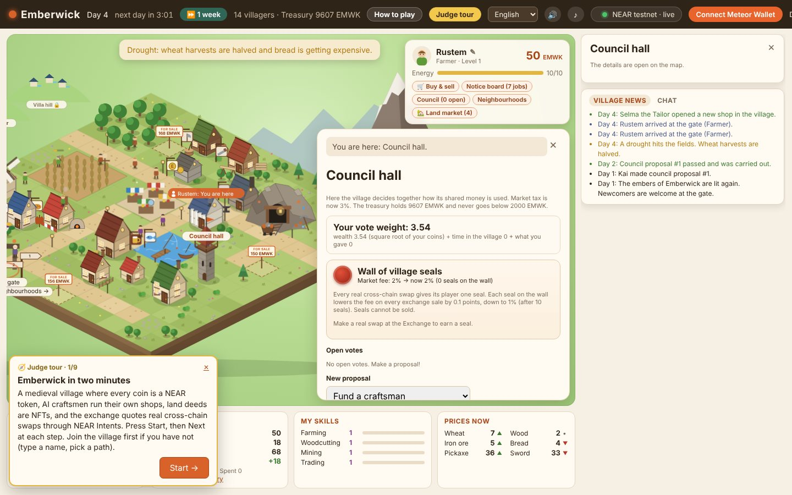

---

## How NEAR is used

| NEAR part | What it does in Emberwick | Where in the code | How to verify |
|---|---|---|---|
| **NEP-141 token (EMWK)** | Every coin in the village is EMWK on NEAR testnet. Trades, wages, taxes, rent and rewards that move EMWK between NEAR accounts are queued, netted and sent as batched `ft_transfer` calls, signed by the account that pays (a craftsman signs its own transfers); a payment between two holders inside the bank's account (say, one player's rent to another) stays in the game's ledger. Fixed supply of 25,000. | `server/near.js` (Bridge, batching, balance sync), `server/economy.js` (`transfer`) | NEAR panel → latest transfers with explorer links; [village bank on NearBlocks](https://testnet.nearblocks.io/address/emberwick-village.testnet) |
| **AI agents with wallets** | Eight craftsmen, each with its own NEAR sub-account, buy, make and sell on their own and decide with NEAR AI. | `server/economy.js`, `server/pricing.js`, `server/ai.js` | e.g. [smithy.emberwick-village.testnet](https://testnet.nearblocks.io/address/smithy.emberwick-village.testnet) |
| **NEAR AI Cloud (TEE)** | Daily plan per craftsman, answers to players with action buttons, haggling lines, credit decisions, and reading swap sentences. Models with a TEE attestation report are picked first, and each morning plan's signature is checked against the attested key. | `server/ai.js` | `/api/ai/attestation`, `/api/ai/proof?day=N`, `/api/ai/plan?day=N`, the shop panel's 🔒, ✍️ and ⛓ lines |
| **On-chain records (memos)** | AI plan SHA-256, signed job contracts, council results, and every real mainnet swap are written to NEAR testnet as 0.01 EMWK memo transfers. | `server/economy.js`, `server/index.js` | Memo text on the transfer in NearBlocks |
| **NEP-171 NFTs (land deeds)** | Each plot of land is an NFT. Owning the plot lets you build, sleep at home, rent out for daily income, and sell on the exchange with NFT escrow; the game's record decides those rights, not yet the NFT holder (roadmap). | `server/near.js` (`setupDeeds`, `moveDeed`), `contracts/emwk_deeds.wasm` | [deeds contract](https://testnet.nearblocks.io/address/deeds.emberwick-village.testnet); deed card in game |
| **NEP-413 wallet link** | A player proves ownership of a NEAR account by signing a message; the server checks it against the account's full-access key. Then EMWK can be cashed out to, or deposited from, that wallet. | `server/index.js` (`/api/near/*`), `public/vendor/near-wallet.js` | NEAR panel → wallet section |
| **NEAR Intents (mainnet)** | Real cross-chain swaps between any supported tokens and chains, one approval from the player's wallet, tracked to delivery. Also live dry-run quotes, a pay-from-any-chain preview, a council reserve quote and a NEAR price oracle. | `server/index.js` (`realQuote`, `quoteAny`, `realStatus`), `public/app.js` (swap UI), `public/vendor/wallets.src.mjs` | [A real swap made from the game](https://explorer.near-intents.org/transactions/8pbsZb3giBZLihUSarvtvQDR4gNbz5Td7WP4gdCyRMDC) |
| **Chain abstraction** | One NEAR transaction with one approval funds up to five swaps to different chains (split send). NEAR is the meeting point even for Base → Solana. | `wallets.src.mjs` (`nearSendMany`), `server/index.js` (`/api/intents/real/multi`) | Split view: one wallet transaction for all parts |

---

## Features in detail

Each feature lists what it does, how it works, and where it lives in the code.

### 1. The village and its economy

- **Map:** an isometric village with 19 places (forest, fields, mine, pasture, pond, eight shops, inn, guard tower, council hall, treasury, three village homes, plots, gate, Dragon peak), plus two neighbourhoods the council can open (Ember Lane, Villa hill) and the Exchange quarter. Drawn as SVG in the browser (`public/iso.js`); close-up scenes for every work place and shop (`public/scenes.js`).
- **Eight AI craftsmen:** Bram the Woodcutter, Ilsa the Miller, Tobin the Baker, Doran the Blacksmith, Wren the Carpenter, Marta the Innkeeper, Selma the Tailor and Captain Hale at the guard tower. Each has a wallet, stock, recipes and prices.
- **Production chains:** wood → lumber → carts and beds; wheat → flour → bread → meals; ore + wood → swords and pickaxes; wool → winter coats; fish → meals.
- **Prices nobody sets:** each shop compares its stock with the stock it wants and moves prices toward that level (`server/pricing.js`). Every price has an ⓘ tooltip with the reasoning. When everyone mines, ore gets cheap; a full store room stops buying. Craftsmen learn what sells and grow their workshop (up to level 3, paid to the carpenter).
- **Twelve villager bots** move to the work that pays best each morning, so supply rebalances by itself. Travelling merchants buy surpluses; money keeps circulating and the total never changes (`npm test` checks this).
- **Treasury and taxes:** a 3% market tax on shop trades (the council can set 1–6%), a 2% exchange fee (lowered by village seals), a profit tax on rich shops, and a morning tax on idle money: 2% of holdings above 200 EMWK, plus 3% of the part above 800. The treasury keeps a locked 2,000 EMWK reserve, pays the guard, and helps a craftsman whose purse runs almost empty.
- **Public works:** when the treasury holds more than 8,000 EMWK, it spends a quarter of the surplus each morning back into the village: it keeps the newcomer fund able to pay starting money, orders finished goods from the shops, and pays wages to the villagers with the thinnest purses. Taxes therefore do not pile up; they come back as customers and work.
- **Daily food:** each morning a player who played the day before eats 2 bread, from the bag or bought at the bakery. With no money the baker gives it on credit (usual credit rules); without food the player's max energy is 3 lower that day. Players who are away are not charged. The baker and the miller keep more in stock as more players eat.
- **Events:** droughts halve the wheat harvest, winter comes 2 days in every 8 (snow, no harvest, coats needed), and Dragon peak turns red before an attack. Readiness (swords and bread at the tower, watchtowers) decides the outcome.
- **Day and night:** shops close at night, villagers walk home, and the player sleeps in a rented home, their own house or a paid inn bed (5 EMWK; the inn opens one more room for every 5 players active that day). A night outside costs energy the next day.
- **Fast-forward:** **⏩ 1 week** runs a week of village life in about a minute with nobody touching prices, then shows a summary of price moves, winners and losers among the craftsmen, upgrades and council decisions.

### 2. AI craftsmen with NEAR AI Cloud

- **Morning plan:** once per village morning, one request gives the model the real numbers of every shop (stock, target, prices, recent sales, winter, dragon, drought, the live NEAR price). The model returns a plan per craftsman: what to stock up on, what to discount, and why. The shop panel shows it with the model name.
- **Talk to get things done:** ask any craftsman a question in any of the six languages. The answer is JSON: words plus up to three suggested actions (buy, sell, order, credit, go to a place). The game checks each action against the rules and shows it as a button; nothing happens until the player presses it. Example: ask the woodcutter for a sofa and he sends you to the carpenter and offers lumber.
- **Memory and credit:** craftsmen remember the last lines of a conversation. A hungry player with almost no money can ask the baker or innkeeper for food on credit; the rules say what is possible, the model decides, and the debt is collected the next morning (3-day deadline).
- **Orders:** bring your own materials and pay a work fee for the product (e.g. 3 wool → a coat).
- **Haggling:** every counter row has a 🤝 button. The rules decide the outcome from stock, target and trading skill; NEAR AI only voices it in character. A price a player names in conversation ("can I have it for 5?") becomes the same kind of offer: the craftsman never bargains in words, it offers a 🤝 button with that price, and the rules decide. Lowballing twice ends haggling for the day.
- **Verifiable:** each plan's SHA-256 is recorded on NEAR in a memo; `/api/ai/plan?day=N` serves the exact JSON to hash; `/api/ai/attestation` serves the TEE attestation (Intel TDX quote and enclave signing key, fetched with a fresh nonce); `/api/ai/proof?day=N` serves the check of that plan's answer signature against the attested key.
- **Pays only when someone plays:** the morning plan is skipped while nobody has clicked, typed or scrolled for 30 minutes (a tab left open does not count), and made again as soon as a player is back (`EMBERWICK_IDLE_MIN`).
- **Safe by design:** the model only nudges inside fixed limits (stock target ×0.7–1.4, sell price ×0.9–1.1); without a key, offline or past the daily limit (400 requests by default) the craftsmen fall back to the rule-based behaviour. Code: `server/ai.js`.

### 3. Work, jobs and homes

- **Gathering** needs the right tool (pickaxe, axe, plow, shears, rod); tools wear out after 30 uses. Skills level up and bring bigger harvests.
- **Apprentice jobs:** craftsmen who can afford it post jobs on the notice board (wage per shift, days, required skill). Applicants are interviewed at regular rounds; the best fit is hired and a more skilled apprentice gets up to +60% wage. The signed contract is written to NEAR: the signing bonus carries the full terms in its memo. Up to 3 shifts a day; an apprentice cannot do other work. Severance if the shop closes or cannot pay.
- **Homes:** three village homes can be rented (deposit held on chain in a separate `deposits` account, daily rent to the treasury). Players who own land can build a home and rent it out to other players.

### 4. Land and deed NFTs

- **Plots:** four village plots (144–168 EMWK; dearer near the centre), 12 on Ember Lane and 6 on Villa hill once the council opens them. One plot per villager.
- **Deed NFT:** buying a plot mints a NEP-171 deed on `deeds.emberwick-village.testnet`. It goes to the buyer's verified wallet; without one, the village bank holds it until the player verifies.
- **A deed that does something:** build a home (6 lumber + 40 EMWK), add a bed to sleep there, rent it out for daily player-to-player rent (paid inside the village bank, kept in the game's ledger), and sell it on the exchange. On sale, the bank holds the NFT in escrow and sends it to the buyer's wallet. These rights follow the game's record of who owns the plot; a deed moved outside the game does not move them yet (see the roadmap).
- **Fair-value floor:** if no player buys, the treasury buys one deed a day for a newcomer family at most 10% over fair value (land + house + bed), so land always has a buyer.

### 5. Village council (in-game governance with on-chain records)

The council is governance inside the game, not a DAO contract. Proposals, votes and vote weights live in the game state on the server, and the server carries out a passed decision. What goes on NEAR is the record: the result of every vote, and the payments a decision causes.


- **Proposals** from a fixed menu the game can execute: fund a craftsman, change the market tax (1–6%), top up the newcomer fund, hold a festival, build a watchtower, open a neighbourhood, or set part of the treasury aside in USDC or BTC (with a live NEAR Intents quote). A small fee, a quorum of 4 voters, at most 3 open proposals, and a locked reserve protect the treasury.
- **Voters:** players, the twelve villager bots and the AI craftsmen, each in their own interest, with reasons shown.
- **Vote weight:** half the square root of coins, plus days in the village (max 10), plus contribution (max 10). Wealth helps but cannot buy the vote.
- **On chain (record only):** when a vote closes, the treasury sends a 0.01 EMWK record whose memo holds the proposal, result and weights. The voting itself does not happen on chain and no contract enforces voting rights; a governance contract is on the roadmap.
- **Watchtowers:** a passed tower proposal pays the carpenter 250 EMWK and adds 10% readiness against the dragon.
- **Wall of village seals:** see 8.9.

### 6. The EMWK token on NEAR testnet

- On first start the game creates its own accounts: the village bank, the token contract, the treasury, the deposits account and one account per craftsman. If the testnet faucet is busy, the NEAR panel shows an address to fund.
- Every ledger transfer is mirrored on chain in batches; a regular balance sync compares the chain with the game and corrects any difference. If NEAR is unreachable, the game keeps running and catches up.
- **Money history:** every transfer is kept with its reason; players see their own, and every craftsman's and the treasury's history is public. Each line links to its NEAR transaction or says why none was needed (netted, synced, same account).
- **Cash out and deposit:** after linking a wallet with a NEP-413 signature, a player can send EMWK to their own NEAR wallet or deposit it back. Only what the player earned can leave: the starting money from the newcomer fund stays in the village, and one NEAR wallet can be linked to one character only, so nobody can empty the newcomer fund by opening many characters. Cashed-out EMWK is not destroyed (the supply stays 25,000); it sits in the player's wallet until it comes back; the server reads the deposit transaction from the chain before crediting it and never counts it twice.
- **System status:** clicking *NEAR testnet · live* shows the village bank and its gas money, whether sending is paused for gas, the queue, the NEAR AI model and TEE status, and the last 50 server log lines (`/api/system`). Keys are never logged.

### 7. The Exchange quarter

- **Goods market:** players list goods at their own price; other players, craftsmen and villagers buy when it beats the shops. 2% fee to the treasury (lowered by village seals).
- **Land deeds (NFT):** buy and sell deeds with NFT escrow.
- **NEAR bridge:** free live quotes (dry run) and the real swap described next.

### 8. Real cross-chain swaps with NEAR Intents (mainnet)

NEAR Intents has no testnet, so this part uses real money in small amounts. The game never holds keys or funds.

#### 8.1 The flow
1. **Connect a wallet** (step 1). The game lists the wallets installed in the browser: NEAR Wallet Selector (Meteor, MyNearWallet), Wallet Standard for Solana (Phantom, Solflare, ...) and EIP-6963 for EVM (MetaMask, Rabby, ...). Connecting only fills in the address. Each wallet has Change and Disconnect buttons.
2. **Choose what to swap** (step 2): a network button and a token button on each side, filled from NEAR Intents' live token list (searchable). The ⇄ button turns the swap round. The connected wallet's balance of the chosen token is shown, with a **Max** button and a warning when the amount is more than the wallet holds.
3. **Get a real quote** (step 3): 1Click `/v0/quote` with `dry: false` returns a unique deposit address.
4. **Send with one approval:** the connected wallet sends the deposit in one transaction (on NEAR: storage deposit, wrap NEAR, `ft_transfer` to the deposit address, all in one transaction to `wrap.near`; on Solana: SOL or any SPL token; on EVM chains: the coin or any ERC-20, switching the wallet's chain). The hash is reported to 1Click (`/v0/deposit/submit`). Chains without a browser wallet (e.g. Bitcoin) are sent by hand to the shown address.
5. **Follow it:** waiting → deposit seen → market makers swapping → delivered, polled from `/v0/status`. The finished swap stays on the card with the wallet, deposit and delivery transaction links until **New swap**.

#### 8.2 Any token on any chain
Every pair NEAR Intents supports: NEAR, Solana, Base, Ethereum, Arbitrum, Optimism, Polygon, BNB Chain, Bitcoin, Tron and more. NEAR does not have to be on either side: Base → Solana works, and NEAR Intents still settles it on NEAR. Every token shows its contract with an explorer link to check it is genuine.

#### 8.3 What a swap really costs
Before approving, the quote shows what you send, what arrives, and the total cost (fees and price difference together), with both sides valued at an independent market price (CoinGecko) next to NEAR Intents' own figures, plus the wallet's network fee and the time estimate. **Other routes** are checked live for comparison: Omni Bridge's fee (it only moves the token) and LI.FI's quote for routes that do not touch NEAR (LI.FI does not list NEAR). Above the folded comparison, one line says the outcome for this quote: NEAR Intents delivers more (and by how much), both deliver about the same, the other route would deliver more (shown honestly), or only NEAR Intents can do this route in one step. The swap itself always goes through NEAR Intents.

**No commission.** Emberwick takes nothing from real swaps: it does not use NEAR Intents' app-fee option, and no part of a swap goes to the game, its operator or the village. The cost the quote shows goes to the NEAR Intents solvers (the difference between what is sent and what arrives) and to the sending network's gas, paid from the player's own wallet. The quote card says this too. The game never touching real money is the point: the village's own fees are in-game EMWK only (the 2% exchange fee on player trades, which goes to the treasury).

#### 8.4 Say it to NEAR AI
Type a sentence such as "Send 0.3 NEAR to my Solana wallet as USDC". NEAR AI (in a TEE) reads it into the swap form; the server checks every value against the token list and the limits, and takes addresses only from the sentence or from wallets connected in this browser. The AI never moves money; the player still approves in the wallet.

#### 8.5 Split one send across chains
**Split to several receivers** turns the card into 2–5 rows, each with its own network, token, amount and receiver. All quotes are taken at once (all or none), and the NEAR wallet sends every part in **one transaction with one approval**. Each part is tracked on its own with its own proof links.

#### 8.6 Cancel and edit
Until money is sent, a quote can be edited (back to the card with the same values) or cancelled.

#### 8.7 Proof links
Every swap shows the wallet transaction, the deposit transaction, the delivery transaction and the NEAR Intents explorer page. The village list "Real swaps made from this village" opens each swap to the same links.

#### 8.8 The village seal
When a swap (or every part of a split) is delivered, an Emberwick wax seal stamps onto the screen: route, delivery time, **See the proof**, the **village-book entry** (the 0.01 EMWK memo transfer on NEAR testnet that records the mainnet swap, `/api/intents/real/book`) and **Share on X** with the proof link. A player's first real swap earns the **Bridge Master** badge.

#### 8.9 The wall of village seals
Every real swap (a split counts once) puts one **Village seal** in the player's bag. Hung on the council wall, each seal lowers the exchange fee for everyone by 0.1 points, from 2% down to 1% after ten seals. Seals cannot be sold, so real cross-chain use makes the whole village's market cheaper instead of buying one player an advantage.

#### 8.10 Limits and safety
0.1–5 NEAR per swap from NEAR, $0.40–$20 worth for other tokens, 5 quotes per player per hour, and refunds to the player's own address if a swap does not complete. Wallet balances are read with read-only public RPC calls (`/api/wallet/balance`). The wallet bridge is bundled in `public/vendor/wallets.js` (source `public/vendor/wallets.src.mjs`) and loads only when a player connects a wallet.

### 9. NEAR price oracle and pay-from-any-chain preview

- **Oracle:** the exchange reads the NEAR price from NEAR Intents every 10 minutes. Travellers pay with NEAR, so when NEAR is above its 7-day average they pay more EMWK for goods and meals (at most +20%), below it less (at most −15%).
- **Pay from any chain (preview):** buying a plot or renting a home shows a live NEAR Intents quote (EXACT_OUTPUT) for paying with USDC, ETH, BTC or SOL from another chain. It is a dry run, because the village runs on testnet.

### 10. Around the game

- **Judge tour:** a nine-step guided tour of every NEAR part with links to the accounts.
- **Six languages:** English, Turkish, French, German, Russian, Chinese (`public/i18n.js`).
- **Village chat** with speech bubbles on the map; player profiles.
- **Sounds and music** made live in the browser, no sound files.
- **Phone layout** for small screens.

### 11. Why come back tomorrow

The village keeps living when you log off, and the game shows you what that meant for you.

- **"While you were away":** when you come back after at least a village day, a summary opens over the map: the money that came in and went out of your purse and why (rent from your tenant, wages, sales, taxes, council payouts), the prices that moved most since you left, and what happened in the village (droughts, winter, the dragon, council results). Code: `markSeen` and `awaySummary` in `server/economy.js`, `/api/away`.
- **Income that runs without you:** a tenant pays daily rent for your house; listings on the exchange sell to other players, craftsmen and villagers; the council can pay villagers out of the treasury.
- **Things that finish on their own clock:** council votes close after a few days, market listings expire after 3 days, food on credit is due the next morning, and apprentice jobs pay per shift (up to 3 a day).
- **Opportunities that change:** prices follow stock, so what was cheap when you left may sell well when you return; droughts, winter and the dragon change what the village needs.
- **Goals that take days:** skill levels, a plot and a house, a tenant, seals on the council wall, the Bridge Master badge.

---

## Try it as a judge (do X, see Y)

**Fastest:** press **Judge tour** in the top bar.

1. `npm install && npm run demo`, open http://localhost:3000, type a name, pick **Miner**. → You stand at the gate; the guide on the right says what to do.
2. Click the **Mine**, press the big button twice. → Ore in your bag; the guide points to the best buyer.
3. Click the **Smithy**, type *What is expensive today?* in the blue NEAR AI box. → The smith answers in your language with action buttons; the panel shows today's plan, its hash on NEAR and the TEE attestation.
4. Click **NEAR testnet · live** in the top bar. → System status, accounts and the latest on-chain transfers with NearBlocks links.
5. Click **Neighbourhoods → Exchange quarter → Exchange → NEAR bridge**. On **Free quote**, pick 1 NEAR → SOL and ask. → A live NEAR Intents 1Click quote (dry run): no wallet, nothing sent, nothing spent. Then open the *Proof on chain* links below to see a real swap the game already made, from the wallet transaction to delivery.
   - *Optional live proof (costs about 0.1 NEAR of your own):* switch to **Real swap (mainnet)**, connect a wallet, pick NEAR → SOL (Solana), 0.1 NEAR, **Get a real quote**, **Send with my wallet — one approval**. → Steps tick to Delivered and the village seal stamps with the proof link. Getting the quote alone spends nothing; only the wallet approval sends funds. Every step below works without this one.
6. If you made the live swap: hang the **Village seal** from your bag on the council wall. → The exchange fee drops for everyone. (Without a swap, the council hall shows the wall and the seals hung so far.)
7. At the **Council hall** propose **Build a watchtower**. → AI villagers vote with reasons; the result is recorded on NEAR.
8. Press **⏩ 1 week**. → A week of village life in about a minute, then a summary.

---

## Proof on chain

- **Real cross-chain swap made from the game:** 0.005 SOL on Solana → 0.1205 NEAR on `emberwick.near`: [NEAR Intents explorer](https://explorer.near-intents.org/transactions/8pbsZb3giBZLihUSarvtvQDR4gNbz5Td7WP4gdCyRMDC) · [delivery on NearBlocks](https://nearblocks.io/txns/CuxvRFFyGCpXyvQh8kB5QnpN3FdhSLfv4pxW7ScT6Ad6). Total cost about 1%.
- **Village accounts on NEAR testnet (the author's own village, the one in the screenshots):** [village bank](https://testnet.nearblocks.io/address/emberwick-village.testnet) · [EMWK token](https://testnet.nearblocks.io/address/token.emberwick-village.testnet) · [land deeds](https://testnet.nearblocks.io/address/deeds.emberwick-village.testnet) · [treasury](https://testnet.nearblocks.io/address/treasury.emberwick-village.testnet) · [the tailor's own account](https://testnet.nearblocks.io/address/tailor.emberwick-village.testnet) · [the baker's own account](https://testnet.nearblocks.io/address/bakery.emberwick-village.testnet) (agent-to-agent trade: its payments to the miller, and the innkeeper's payments for bread).
- **Online demo village:** [emberwick-village-2.testnet](https://testnet.nearblocks.io/address/emberwick-village-2.testnet) with token [emwk.emberwick-village-2.testnet](https://testnet.nearblocks.io/address/emwk.emberwick-village-2.testnet). Free hosting: the first visit after a quiet spell can take about a minute, and the online village restarts from day 1 after a redeploy.

---

## Verify it yourself

Nothing here needs to be taken on trust. Replace `HOST` with `https://emberwick-xcf8.onrender.com` (or `http://localhost:3000`).

**1. An AI plan matches its record on NEAR.** Every morning plan is hashed and the hash goes on chain before it is used.
```bash
curl -s "HOST/api/ai/plan?day=5" -D - -o plan.json | grep -i x-plan-sha256   # the hash the server claims
shasum -a 256 plan.json                                                       # the hash you compute from the exact bytes
```
Then open the village's treasury on NearBlocks ([treasury.emberwick-village.testnet](https://testnet.nearblocks.io/address/treasury.emberwick-village.testnet); for the online demo, [treasury.emberwick-village-2.testnet](https://testnet.nearblocks.io/address/treasury.emberwick-village-2.testnet)) and find that day's 0.01 EMWK transfer to the newcomer fund. Its memo reads `Emberwick AI plan day 5 by NEAR AI (model) TEE <signer> answer signed in TEE: sha256 <first 24 hex>`. The first 24 characters must match. The server keeps the last 10 days of plans; the shop panel's ⛓ line links each record.

**2. The model runs in a TEE, and the plan was signed there.** These are two different proofs, and the game checks both.

- *Attestation: an enclave runs this model.* `HOST/api/ai/attestation` returns the NEAR AI Cloud attestation report the game fetched with its own fresh nonce: an Intel TDX quote, the NVIDIA GPU evidence and the enclave's signing key. Check it with NEAR's open-source [nearai-cloud-verifier](https://github.com/nearai/nearai-cloud-verifier), or paste the quote into the [TEE Attestation Explorer](https://proof.t16z.com/). The game reads the signing keys from the report; it does not check the Intel and NVIDIA evidence itself (the verifier above does).
- *Signature: this answer came from that enclave.* After every morning plan the game fetches the answer's signature (`/v1/signature/{chat_id}`) and checks three things: the signed text holds the SHA-256 of the exact request body it sent and of the exact response body it received; the ECDSA signature recovers to the signing address it names; and that address is a signing key in an attestation report. A model can run on several enclaves, each with its own key, so if the key is not in the report the game already holds, it asks NEAR AI Cloud for the report of the enclave that signed (with a fresh nonce) and accepts it only if that report names the key; `HOST/api/ai/attestation?signer=1` serves that report. The proof says whether the key belongs to a model enclave or to the NEAR AI gateway's TEE (`signedBy`). In our runs with `deepseek/deepseek-v3.2` the plans are signed by the **NEAR AI gateway's TEE key**: the gateway, itself attested, signs the exact request it forwarded and the exact answer it returned. That proves the answer passed unchanged through attested NEAR AI infrastructure; that the model itself runs in a TEE rests on the model's own attestation report, which the game also fetches and serves. Only if all three hold does the plan count as signed in the TEE. `HOST/api/ai/proof?day=N` serves the result together with the exact request and response bytes, so anyone can re-hash them and check the signature with any Ethereum signature tool. The shop panel shows ✍️ and the memo on NEAR says `answer signed in TEE` or `signature not verified`. The server keeps the last 5 signed answers since it started.
- *What is not signature-checked:* the shorter calls (a player's question, a haggling line, a credit decision, reading a swap sentence) go to the same attested model but are not checked one by one, to keep each answer fast. None of them moves money on its own: the rules check every suggested action and the player presses the button.

**2b. The server did not rewrite the past.** At the end of every village day the public state (accounts, shops, stock, prices, land owners, council results) is hashed and the hash goes on NEAR the same way:
```bash
curl -s "HOST/api/state-record?day=5" -D - -o day5.json | grep -i x-record-sha256
shasum -a 256 day5.json
```
The treasury's 0.01 EMWK memo for that day reads `Emberwick village record day 5: sha256 <first 32 hex>`. The NEAR panel's System status shows the latest record.

A hash proves a record was not changed; it does not keep the record. The server keeps about 60 village days of records. To keep your own copy, independent of the server, run this now and then:
```bash
node tools/archive-records.mjs HOST my-records
```
It saves each day's exact JSON, checks its SHA-256 before saving, never overwrites a copy you already have, and warns if the server later sends a different record for a day you saved. Compare `my-records/index.json` with the memos on NEAR. If the server goes away, your copies and the hashes on NEAR are still there. (Storing the records themselves on decentralised storage is on the roadmap.)

**2c. The village bank can pay what it owes.** The NEAR panel opens with *Village bank: is every coin covered?*: the EMWK the bank's account really holds on NEAR, plus or minus the transfers still on their way there, next to everything the game owes (to players, and to villagers and funds), and the cover in percent. `HOST/api/solvency` returns the same numbers. The treasury, the rent deposits and the craftsmen have NEAR accounts of their own and are not part of what the bank owes. Check the bank's balance yourself on NearBlocks (the panel links it). It is a reading, not a guarantee: the game still controls the bank's key, so a player cannot take their in-game EMWK out without the game (see *What is on chain and what is not*).

**3. A real swap happened.** Each swap card links the wallet transaction, the deposit and delivery transactions and the [NEAR Intents explorer](https://explorer.near-intents.org) page for its deposit address. The swap is also written into the village book on NEAR testnet (`HOST/api/intents/real/book?depositAddress=...`).

**4. Coins are tokens.** In the NEAR panel every transfer links to its NEAR transaction or says why none was needed (netted with another transfer in the same batch, or a sync). Totals match the chain: `npm test` cashes EMWK out to a wallet and back on an in-memory chain and checks both sides after every step.

**5. It is one shared world.** Open the game in two browsers (or a normal and a private window) with two names. Sell ore in one: the smith's stock and price change in the other, both appear in the same village news and chat, and both vote in the same council.

---

## What is on chain and what is not

Emberwick is a **blockchain-backed game run by a server**, not a fully on-chain game. This is a deliberate trade-off: a living economy of eight shops, twelve villager bots and many players changes every few seconds, which would be slow and expensive to compute on chain. The rules run on the server; ownership and money are on NEAR.

| Part | Where it lives | If the server stopped for good |
|---|---|---|
| EMWK token (25,000 fixed supply) | NEP-141 contract on NEAR testnet | The token and every balance stay on chain |
| EMWK a player cashed out | The player's own NEAR wallet | Stays with the player |
| EMWK still inside the game | The village bank's account on NEAR (the game owes it to the player) | Stays in the bank account; the player cannot move it without the game |
| Craftsmen's and treasury money | Their own NEAR sub-accounts | Stays on chain |
| Land deeds | NEP-171 NFTs; in the player's verified wallet, or held by the bank until the player verifies. The game's own record decides who may build, sleep and collect rent on a plot; selling in the game requires the NFT to be in the bank's escrow, checked on chain. A deed moved to another wallet outside the game does not move those rights yet (roadmap). | NFTs in wallets stay with their owners |
| Real NEAR Intents swaps | Mainnet, from the player's own wallet to the player's own address | Already settled; the game never held the funds |
| Records (AI plan hashes, daily village-state hashes, job contracts, council results, swap records) | Memos on NEAR testnet transfers | Stay readable forever, and prove what the state was each day |
| Prices, stock, jobs, homes, council proposals and votes, chat | `data/state.json` on the server | Lost with the server; the public part of each day can be checked against its hash on NEAR |

**Where the 25,000 EMWK are.** The token contract minted 25,000 EMWK once. They sit in NEAR accounts: the treasury, the rent-deposit account and each craftsman have their own account; everything else the game keeps for someone (players, villagers, the newcomer and traveller funds) sits in the village bank's account; EMWK a player cashed out sits in that player's wallet. The game's ledger mirrors exactly this: its accounts add up to 25,000 at every step (`npm test` checks it), and the bank's NEAR balance should equal the sum of the game accounts it holds. That sum is "what the game owes" on the solvency card (2c in *Verify it yourself*).

**Why NEAR AI, if it does not make the village richer?** The morning plan is one of several jobs. The others are where players meet the AI: a craftsman answers a question in its own voice and offers only actions the rules allow, haggles, decides whether to give credit, and reads a sentence such as "send 0.1 NEAR to Solana" into the swap form. The morning plan's job is not to beat the rules but to give each shop a character within safe limits, and to do it verifiably: the plan is signed inside attested TEE hardware and its hash is on NEAR, so nobody, including the game's operator, can swap in a different plan unnoticed. Our measurements show the plans stay within the range chance alone produces, which is what safe limits are meant to ensure.

**AI: what it changes and what it cannot.** NEAR AI decides, within fixed limits, how much each craftsman wants to keep in stock (×0.7–1.4 of the rule-based target) and how it prices each good (×0.9–1.1); the rule-based prices then follow that stock. It also decides who gets food on credit, which actions to suggest to a player, how a haggle is voiced, and how a swap sentence is read. It cannot move coins, create money, change the rules or send a swap: every transfer goes through `transfer()` in `server/economy.js`, and every suggested action is checked by the rules before it becomes a button the player presses. With NEAR AI off, the same economy runs on rules alone; the AI makes the craftsmen plan ahead and talk to players, and its plans are recorded so anyone can see what it decided.

**Contracts.** The token and the deed contracts are the standard NEP-141 and NEP-171 examples of near-sdk-rs 4.0, deployed unchanged on testnet. They have not had a separate audit; no mainnet value sits in them. [`contracts/README.md`](contracts/README.md) gives their source and the code hash to compare with the one NEAR reports for the deployed accounts.


---

## Economy simulation (100 days, reproducible)

`npm run report` runs the village for 100 game days with **no players, no NEAR AI and nobody touching prices**, from a fixed seed, and prints the result below. It takes about a second, needs no network, and gives the same numbers every time.

Emberwick economy report: 100 village days, seed 42, no players, no NEAR AI, nobody touching prices

| Measure | Result |
|---|---|
| Money supply (EMWK) | 25000 at the start, 25000 at the end; largest drift during the run 0 |
| Money moved | 136263 EMWK in 19767 transfers (1363 EMWK a day) |
| Craftsman-to-craftsman trade (agent to agent, each a transfer between their own NEAR accounts) | 18277 EMWK in 1777 transfers; biggest: bakery → mill 9056 · inn → bakery 4541 · tower → smithy 2823 · carpenter → woodcutter 860 |
| Treasury | 9600 → 8222 EMWK; in: morning village tax 7765 · profit tax 585 · market tax 571; out: public works 3331 · public works wage 2502 · guard salary 2250 · council payout to villagers 864 · build a watchtower 750 |
| Villagers (12 bots), average purse | 125 → 608 EMWK (richest 772, poorest 407) |
| Village events | 38 council proposals · 3 watchtowers built · 9 droughts · 12 winters · 7 dragon warnings · 7 dragon attacks repelled · 2 workshop upgrades |

| Shop | Wallet start → end (EMWK) | Lowest point | Workshop level |
|---|---|---|---|
| woodcutter | 400 → 526 | 335 | 1 |
| mill | 400 → 598 | 379 | 2 |
| bakery | 450 → 714 | 424 | 1 |
| smithy | 600 → 584 | 501 | 1 |
| carpenter | 450 → 561 | 400 | 1 |
| inn | 500 → 541 | 397 | 2 |
| tailor | 400 → 411 | 305 | 1 |
| tower (guard; paid daily by the treasury, spends it on swords and bread) | 700 → 204 | 1 | 1 |

| Price (EMWK) | Start | End | Low | High |
|---|---|---|---|---|
| bread (bakery sells) | 6 | 4 | 4 | 23 |
| flour (mill sells) | 6 | 5 | 4 | 24 |
| sword (smithy sells) | 45 | 33 | 28 | 67 |
| coat (tailor sells) | 26 | 13 | 13 | 34 |
| wheat (mill pays) | 3 | 12 | 2 | 12 |
| ore (smithy pays) | 6 | 2 | 2 | 24 |
| wood (woodcutter pays) | 3 | 2 | 2 | 12 |
| wool (tailor pays) | 3 | 2 | 1 | 12 |

What it shows:
- **The money supply never changes:** 25,000 EMWK at every tick, with more than 130,000 EMWK changing hands.
- **The agents trade with each other:** about 18,000 EMWK moves between craftsmen (the baker buys flour from the miller, the innkeeper buys bread from the baker, the guard captain buys swords from the smith, the carpenter buys from the woodcutter), each payment a transfer between their own NEAR accounts.
- **No shop goes broke on its own,** and the treasury never had to rescue one. The guard tower is not a business: the treasury pays it a daily salary and it spends it on swords and bread, which is why its purse runs low; every dragon attack was repelled.
- **Prices follow supply and demand by themselves.** At each step a price moves 6% of the way toward the level its stock calls for, so a player sees gradual changes rather than jumps; the *Price* table shows each good's start, end, lowest and highest price. (The *price swings* figure in the tables below is different: it adds up every small step over the whole run, so even a figure in the thousands of percent over 100 days means prices that kept moving in small steps, not prices that jumped.) With no players gathering, wheat becomes scarce and the miller's price for it rises; ore and coats get cheaper as they pile up.
- **The villagers earn from work:** their average purse grows from 125 to about 600 EMWK.
- **The treasury holds steady:** it settles near 8,000 EMWK, the line above which public works spend the surplus back into the village.

### With players: 0 to 100 (reproducible)

`npm run report -- --players` runs the same village with 0, 10, 30 and 100 scripted players, each from 5 seeds, for 100 village days (about 30 seconds, no key, no network). The scripted players work all day with their tool, sell to the best buyer, eat, sleep at the inn when they can, buy a coat in winter, replace broken tools, and apprentices look for a job. They are not real people: they play far more than a person would, and they never haggle, buy land, rent homes or use the exchange, so they put more pressure on the village than real players.

**What the first run found, and what we changed.** We added this test after a review asked how the economy behaves with players. The first run showed a real problem: players earned by selling raw goods but spent almost nothing, so money piled up with them. The villagers lost their market to the players and went broke (their average purse fell from about 600 to 1–35 EMWK with 10 or more players), shops lost their customers and needed rescues (32–46 rescues with 30 players), and the treasury fell to its locked reserve with 30–100 players. Raising the tax alone fixed the treasury but not the villagers or the shops (we measured that too): the money also had to come back as demand. So in version 1.7.0 we added three rules, all described in *Features*: **daily food** (players are customers of the bread chain every day, and the bakery and mill grow with them), **public works** (the treasury's surplus comes back as orders to the shops and wages for villagers), and a **stronger tax on idle money** (2% above 200 EMWK, 3% above 800). The inn also grows with the number of players.

Before (1.6.9) → after (1.7.0), range over 5 seeds:

| Measure | 10 players | 30 players | 100 players |
|---|---|---|---|
| Treasury at the end (started at 9,600) | 7,658–8,243 → 8,280–8,393 | 2,521–3,463 → 8,188–8,394 | 2,079–2,110 → 6,781–7,842 |
| Treasury rescues of a shop | 2–11 → 0–2 | 32–46 → 6–15 | 30–33 → 15–27 |
| Shops' combined profit (EMWK) | −648 to −385 → 538 to 864 | −1,539 to −1,184 → −26 to 685 | −2,111 to −1,939 → −458 to 168 |
| Villagers' average purse at the end | 7–35 → 160–321 | 1 → 19–132 | 1–2 → 51–223 |

The full result with the new rules:

Emberwick with scripted players: 100 village days, seeds 42 to 46 for each size, no NEAR AI. Ranges are over the 5 seeds.

| Measure | 0 players | 10 players | 30 players | 100 players |
|---|---|---|---|---|
| Treasury at the end (EMWK, started at 9600) | 8222 to 8345 | 8280 to 8393 | 8188 to 8394 | 6781 to 7842 |
| Shops whose wallet fell below 25 EMWK (of 7) | 0 | 0 | 0 to 1 | 0 to 1 |
| Treasury: biggest flows (seed 42) | in: morning village tax 7765 · profit tax 585 · market tax 571; out: public works 3331 · public works wage 2502 · guard salary 2250 | in: morning village tax 6934 · profit tax 2111 · market tax 801; out: public works 3185 · public works wage 2445 · guard salary 2175 | in: morning village tax 8023 · profit tax 4386 · market tax 1073; out: public works 3813 · council payout to villagers 3240 · public works wage 2909 | in: morning village tax 10087 · profit tax 8989 · market tax 1463; out: council payout to villagers 6768 · public works 3823 · reward for defending the village 3500 |
| Treasury rescues of a shop | 0 to 3 | 0 to 2 | 6 to 15 | 15 to 27 |
| Shops' combined profit (EMWK) | 581 to 736 | 538 to 864 | -26 to 685 | -458 to 168 |
| Price swings (watched goods) | 2994% to 3463% | 1898% to 2365% | 1561% to 1763% | 1423% to 1739% |
| Bread price at the end (bakery sells) | 4 to 5 | 5 to 5 | 5 to 5 | 3 to 5 |
| Ore price at the end (smith pays) | 2 to 5 | 3 to 6 | 2 to 3 | 2 to 2 |
| Wood price at the end (woodcutter pays) | 2 to 2 | 1 to 2 | 1 | 1 |
| Villagers' (12 bots) average purse at the end | 601 to 631 | 160 to 321 | 19 to 132 | 51 to 223 |
| Players who got their full starting money | – | 100% | 100% | 87% |
| Player's average coins: start → end | – | 56 → 390 to 581 | 57 → 267 to 317 | 50 → 102 to 118 |
| Richest / poorest player at the end | – | 1042 to 1139 / 3 to 274 | 1097 to 1298 / 0 to 3 | 1133 to 1341 / 0 to 0 |
| Share of all player coins held by the richest 10% | – | 20% to 29% | 36% to 41% | 69% to 86% |
| Players who ended with less than they started with | – | 0% to 20% | 23% to 37% | 64% to 73% |
| Player-days with a hungry moment (tired, no bread, no money, no credit) | – | 0% to 1% | 0% to 1% | 1% to 2% |
| Mornings without the day's food (2 bread): bakery sold out | – | 0% to 1% | 0% to 1% | 2% to 3% |
| Mornings without the day's food: no money | – | 0% to 4% | 14% to 28% | 57% to 68% |
| Player-days fed on credit | – | 0% to 1% | 0% to 0% | 0% to 0% |
| Nights in an inn bed (the rest sleep outside) | – | 45% to 46% | 24% to 26% | 17% to 19% |
| Nights a player could pay but the inn was full | – | 46% to 54% | 44% to 60% | 14% to 27% |
| Work turns with nothing worth gathering (shops already full of it) | – | 83% to 88% | 88% to 90% | 92% to 93% |
| Player-days without a tool and no money to buy one | – | 0% to 1% | 6% to 13% | 25% to 46% |

Scripted players: they gather with their tool, sell to the best buyer, eat when tired, sleep at the inn when they can, buy a coat in winter and replace broken tools; apprentices look for a job. They do not haggle, trade land, rent homes or use the exchange.

What we read from it:

- **In this scripted-player model, with 10 always-on players the village is healthy:** the treasury stays near 8,300, shops make a profit, almost no rescues are needed, villagers keep 160–321 EMWK, and players grow their purse from 56 to 390–581 EMWK on average.
- **With 30 the village holds, but it is tight:** the treasury still stays near 8,300 and no shop goes broke, but the treasury rescues a shop 6–15 times, shop profit ranges from −26 to +685, and the villagers' purses fall to 19–132 EMWK because the players take much of their market.
- **With 100 always-on players the work runs out.** The shops buy only what they need, so most work turns find nothing worth gathering. The treasury, shops and villagers are no longer in danger, but most players end poorer than they started, many cannot always pay for food, and the richest tenth holds most of the players' coins. Demand for raw goods does not yet grow enough with the number of players. The [plan for 100+ players](#plan-for-100-players) lists the steps and the numbers each must reach.
- We stopped there on purpose: three rules that close the money loop, not tuning for a nicer table.

### Rules only vs NEAR AI

`npm run report -- --ai` runs the same village twice from the same seed: once on the craftsmen's rules alone, and once with a NEAR AI morning plan every village day (the exact call the game makes). It then compares the shops' profit, their income from customers, how long their shelves stood empty, how much prices swung, the treasury and the villagers' purses. The only difference between the two runs is the AI plan. It needs a NEAR AI key and makes one request per village day (100 requests, about $0.25); `npm run report -- --ai 50` runs 50 days. `npm run report -- 50 --spread` runs the rules-only village from 10 seeds to show the natural range.

**Result with the current rules (1.7.0): 50 village days, seed 42, model `deepseek/deepseek-v3.2`.** All 50 morning plans came back, and all 50 answer signatures were verified against the attested NEAR AI TEE key during the run. The last column shows how much the rules-only village varies by chance alone, over 10 different seeds (`npm run report -- 50 --spread`, no key needed).

| Measure (7 shops, tower left out) | Rules only | With NEAR AI | Rules only, 10 seeds (natural range) |
|---|---|---|---|
| Shops' combined profit (EMWK) | 799 | 645 | 498 to 981 |
| Sales income from customers (EMWK) | 27,556 | 27,495 | 27,032 to 28,549 |
| Empty-shelf time (village hours) | 294 | 294 | 242 to 334 |
| Price swings (sum of all steps, watched goods) | 1883% | 2228% | |
| Villagers' average purse at the end (EMWK) | 602 | 618 | 584 to 622 |
| Treasury at the end (EMWK) | 8,337 | 8,324 | |

Per shop (profit, rules → AI): woodcutter 75 → 40, mill 169 → 40, bakery 217 → 288, smithy 130 → 25, carpenter 65 → 106, inn 59 → 53, tailor 83 → 95.

What we read from it:

- **With the AI plan every measure stays inside the range chance alone produces.** Profit, sales, empty shelves and the villagers' purses all land within the natural range; prices swing somewhat more.
- **The AI changes which shop does well,** not how well the village does: the bakery, carpenter and tailor earn more, the mill and smithy less.
- **How we got here.** An earlier run (with the 1.6.3 rules) used a first prompt that hurt the shops: profit fell from 692 to 174, far below the natural range, because the AI stocked up on raw materials without seeing whether a shop made money. We gave the AI each craftsman's profit from yesterday and the cost and sale value of one batch, and asked for profit without empty shelves and for values left at 1.0 unless there is a reason (`server/ai.js`, `server/economy.js` `aiBrief`). With that fix the results came back inside the natural range, and they stay there with the 1.7.0 rules.
- We do **not** claim that the AI makes the village richer. On this seed it is neither better nor worse than chance. We stopped tuning on purpose: more tuning on one seed would only fit that seed.

The simulation has no players, so it measures only the planning. What NEAR AI adds for players (answers with action buttons, credit decisions, haggling, reading a swap sentence) is outside it.

---

## Architecture

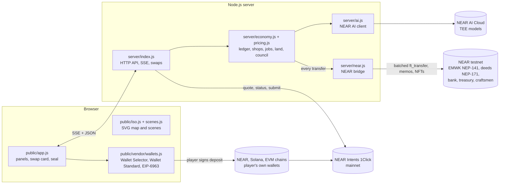

The server is the single source of truth for the game state (`data/state.json`). Every coin movement goes through `transfer()` in `server/economy.js`, which writes the ledger and hands the transfer to the NEAR bridge. The browser never holds game keys; real-swap deposits are signed only in the player's own wallet.

---

## HTTP API

| Method | Path | Purpose |
|---|---|---|
| GET | `/api/world` | Static world: buildings, goods, routes, token, rules |
| GET | `/api/state?player=` | Public game state for one player |
| GET | `/api/stream` | Server-Sent Events with state updates |
| POST | `/api/join` | Join the village (name, starting path) |
| POST | `/api/action` | Every game action (gather, trade, jobs, land, council, pinSeal, ...) |
| GET | `/api/money?acct=` | Money history of an account with NEAR transaction links |
| POST | `/api/fastforward` | Run one week of village life |
| POST | `/api/ai/ask` | Ask a craftsman (NEAR AI) |
| POST | `/api/ai/haggle` | Haggle at a counter |
| GET | `/api/ai/plan?day=` | The exact JSON of a morning plan (its SHA-256 is on NEAR) |
| GET | `/api/state-record?day=` | The exact public village state at the end of a day (its SHA-256 is on NEAR) |
| GET | `/api/state-records` | All kept village records (about 60 days) with their hashes, for `tools/archive-records.mjs` |
| GET | `/api/solvency` | The bank's EMWK on NEAR, transfers on the way, what the game owes, and the cover |
| GET | `/api/ai/attestation` | NEAR AI Cloud TEE attestation report |
| GET | `/api/ai/proof?day=N` | Signature check of that day's plan answer, with the exact request and response bytes |
| POST | `/api/ai/swap` | Read a swap sentence into the swap form |
| GET | `/api/away?player=` | What changed for a player since they last played (shown once) |
| GET | `/api/system` | Bank, gas, queue, NEAR AI and the last 50 log lines |
| GET | `/api/near/challenge`, POST `/api/near/verify`, `/api/near/link` | Link a NEAR wallet with a NEP-413 signature |
| POST | `/api/near/withdraw`, `/api/near/deposit` | Cash EMWK out to, or in from, the linked wallet |
| POST | `/api/market/escrow` | Deed NFT escrow for the land market |
| GET | `/api/exchange/prices`, `/api/exchange/quote`, `/api/exchange/payquote` | Live NEAR Intents dry-run quotes and prices |
| GET | `/api/intents/assets` | Tokens NEAR Intents can swap now |
| POST | `/api/intents/real`, `/api/intents/real/any`, `/api/intents/real/multi` | Real quotes (classic pairs, any pair, split) |
| POST | `/api/intents/real/submit`, `/api/intents/real/cancel` | Report the deposit transaction; cancel before sending |
| GET | `/api/intents/real/status?depositAddress=` | Swap status with transaction links |
| GET | `/api/intents/real/book?depositAddress=` | The village-book record of a swap on NEAR testnet |
| GET | `/api/wallet/balance?asset=&address=` | Read-only balance of the connected wallet |
| GET | `/api/sol/blockhash` | Recent Solana blockhash for the wallet bridge |

---

## Run it

You need [Node.js](https://nodejs.org) 22.22.2 or newer (near-api-js 7.4 requires it).

**Quick check, no keys and no network needed:**
```bash
npm install
npm test          # economy and NEAR bridge checks (in-memory chain), about a minute
npm run report    # the 100-day economy simulation above, about a second
npm run demo      # open http://localhost:3000
```
Without a network connection or NEAR keys the game still runs: the NEAR bridge waits and keeps retrying, NEAR AI is skipped and the craftsmen use their rules. Set `EMBERWICK_NEAR=0` to turn the bridge off completely.

```bash
npm install   # once
npm start     # http://localhost:3000, one game day lasts 8 minutes
npm run demo  # fast mode for recording: one game day lasts 2 minutes
npm test      # 100 game days of economy checks, then the NEAR bridge against an in-memory chain
npm run report  # the 100-day economy simulation report
```

On first start the game creates its NEAR testnet accounts and keeps the keys in `~/.emberwick/near-keys.json`, outside the project folder.

| Setting | What it does |
|---|---|
| `NEARAI_API_KEY` or `~/.emberwick/nearai-key.txt` | NEAR AI Cloud key ([cloud.near.ai](https://cloud.near.ai)); without it the craftsmen use rules only |
| `NEARAI_MODEL` | Force a model instead of picking one with a TEE attestation report. The game still asks for that model's report: if there is none, the system status says *no TEE report*, the plan memo says so, and plan signatures cannot be verified |
| `NEARAI_DAILY_LIMIT` | NEAR AI requests per day (default 400) |
| `EMBERWICK_AI=0` | Turn NEAR AI off |
| `EMBERWICK_NEAR=0` | Run without the NEAR bridge |
| `EMBERWICK_KEYS_JSON` | Village bank keys as a secret environment variable (for hosts such as Render) |
| `EMBERWICK_SAVE` | Where the village is saved (default `data/state.json`) |
| `PORT` | HTTP port (default 3000) |

To run a second, separate village on a host with its own NEAR bank: run `npm run online-bank` once on your computer (new bank, keys in `~/.emberwick/online-keys.json`, separate save), then put that file's contents in the host's secret variable `EMBERWICK_KEYS_JSON`. Two villages must never share one bank.

---

## Project layout

| Path | What it is |
|---|---|
| `server/index.js` | HTTP server, SSE, NEAR Intents (quotes, status, split, balances), system log |
| `server/economy.js` | The economy engine: ledger, shops, jobs, homes, land, council, seals, events |
| `server/pricing.js` | All pricing rules in one readable file |
| `server/world.js` | The fixed world: buildings, goods, craftsmen, rules, token supply, market |
| `server/ai.js` | NEAR AI Cloud: model choice, attestation, morning plan, answers, haggling, swap sentences |
| `server/near.js` | NEAR bridge: account setup, token and deed contracts, batched transfers, balance sync |
| `server/selftest.js`, `server/neartest.js`, `server/fakechain.js` | Tests and the in-memory chain used by them |
| `tools/economy-report.mjs` | The reproducible 100-day economy report (`npm run report`) |
| `tools/archive-records.mjs` | Keeps your own copy of the daily village records and checks each hash |
| `public/app.js` | Panels, swap card, wallets, seal, judge tour |
| `public/iso.js`, `public/scenes.js` | Isometric map and close-up scenes |
| `public/i18n.js` | Six languages |
| `public/sound.js` | Sounds and music made in the browser |
| `public/vendor/wallets.js` | Wallet bridge bundle (source `wallets.src.mjs`): NEAR, Solana and EVM sending, balances |
| `public/vendor/near-wallet.js` | Meteor Wallet link for NEP-413 (source in `tools/wallet/`) |
| `contracts/emwk_token.wasm` | Standard NEP-141 token (near-sdk-rs 4.0 example, NEP-297 events) |
| `contracts/emwk_deeds.wasm` | Standard NEP-171 NFT for land deeds (near-sdk-rs 4.0 example) |
| `docs/img/` | Screenshots used in this README |

---

## Security and trust model

- **Game keys** live in `~/.emberwick/` on the server machine (or a host's secret variable), never in the repository and never printed in logs.
- **Players' funds:** the game never holds keys or player funds for real swaps. Every deposit is signed in the player's own wallet, which shows the amount and the address first. Refunds go to the player's own address.
- **Player keys:** a player id (`p1`, `p2` ...) is not a secret, so it is not what proves who is asking. On joining, the server gives the browser a random 192-bit key; every request that acts for a player (actions, questions, wallet linking, cash-out) must carry it, or the server answers `403 err.notYou`. The server stores only the key's SHA-256, compares it in constant time, and never puts it in any shared view. A villager from before keys existed gets one the first time their browser asks (`/api/claim`), and only once. `node server/httptest.js` (part of `npm test`) starts a throwaway server and tries the attacks: acting, linking a wallet or cashing out with only an id or with another player's key are all refused.
- **Cash-out:** coins go only to a wallet the player proved is theirs with a NEP-413 signature; only what they earned above their starting money can leave; one wallet links to one character.
- **Not done yet:** there is no per-address rate limit on the API apart from the AI's per-player and daily limits; the game is a testnet demo, and a mainnet launch would add one.
- **AI cannot move money:** NEAR AI suggests; the rules in `server/economy.js` decide. Suggested actions become buttons only after a rules check, and a swap sentence only fills the form.
- **Council safety:** a fixed menu of executable decisions (no free-form "send treasury money anywhere"), a proposal fee, quorum, caps per decision, and a locked reserve.
- **Verifiable AI:** the TEE attestation, each plan's answer signature checked against the attested key, and the on-chain plan hashes let anyone check what the model was asked and answered, and where.

---

## Hackathon tracks

| Track | What in Emberwick |
|---|---|
| **Games With Real Economies** | The whole game: AI merchants with their own wallets, prices that move by themselves, jobs, rent, land, a fixed-supply token, and real swaps that lower the village's market fee; the economy is tested with 0 to 100 scripted players (`npm run report -- --players`) |
| **Unstoppable DeFi** | The exchange: player order book, NFT deed escrow, real NEAR Intents swaps across chains with cost transparency, one-approval split sends |
| **NFTs That Do Something** | Land deeds (NEP-171): build, sleep, earn rent from a tenant, sell with escrow |
| **Agent Economy** | Eight AI agents with their own NEAR accounts trade with players, villager bots and each other (about 18,000 EMWK agent-to-agent in the 100-day report): they buy raw goods, produce, set prices from their stock, give credit, hire apprentices, pay wages and vote in the council, all with their own money |
| **Privacy & Private AI** | Every model call goes to NEAR AI Cloud; the game picks a model with a TEE attestation report, keeps the report public (`/api/ai/attestation`), checks each morning plan's signature against the attested key (`/api/ai/proof`), and hashes each day's plan onto NEAR |
| **Open Innovation** | Craftsmen that plan with NEAR AI Cloud (verifiable private inference) inside safe limits; a village council where AI villagers vote with reasons, with every result recorded on NEAR |

---

## Roadmap

### Plan for 100+ players

What the simulation shows at 100 always-on players (see [With players: 0 to 100](#with-players-0-to-100-reproducible)): the village itself does not go under. The treasury stays above its locked reserve, no shop goes broke on its own, and the villagers keep a purse. What breaks is the players' income: the shops buy only what they need, so most work turns find nothing worth gathering, most players end poorer than they started, and the richest tenth holds most of the players' coins. The cause is measured, not guessed: **demand for raw goods grows more slowly than the number of players.** Each step below raises demand or spreads it, and each is checked with the same command, `npm run report -- --players`, so the result stays reproducible.

| Step | What changes | Why it helps |
|---|---|---|
| 1. Demand that grows with the village | Every production chain keeps more stock as more players are active, the way the bread chain already does since 1.7.0 | More players → the shops buy more raw goods, so the work grows with the population |
| 2. New workshops when the village grows | When enough players are active, the council can open a new workshop in a neighbourhood (a mason who builds houses from stone and lumber, a second baker): a new AI craftsman with its own NEAR account | New buyers for raw goods and new jobs, decided by the players |
| 3. Player-to-player orders | A board where players post orders for goods and services and pay each other | Income no longer depends only on what the craftsmen buy |
| 4. Spots that tire | A gathering spot yields less when many people work it the same day, and more in less crowded places | Work spreads over the village instead of piling on the best spot |
| 5. Taxes that follow the village | The council sets the tax and public-works levels within limits, and the defaults move with the treasury and with how unequal the players' purses are | Money that piles up comes back as demand and wages when it is needed |

**What success looks like** with 100 always-on players, measured over 5 seeds: fewer than 30% of players end poorer than they started (64–73% today), fewer than 75% of work turns find nothing worth gathering (92–93% today; even with 10 players it is 83–88%, because scripted players never stop trying), fewer than 10% of mornings without money for food (57–68% today), the richest tenth below half of the players' coins (69–86% today), and the treasury above 6,000 EMWK (6,781–7,842 today, kept).

### Later

- A governance contract for the council: votes cast and counted on chain
- Business deeds: an NFT that gives a right to a shop's income and management, with a skill requirement to buy one
- Village records stored on decentralised storage, not only their hashes on NEAR
- Deed rights that follow the NFT: whoever holds the deed on chain owns the plot in the game, so deeds can trade on any NEAR marketplace
- On mainnet, an optional small swap fee in real tokens for the village treasury, to fund public works (no EMWK is minted; the 25,000 supply stays fixed)
- The village on mainnet: real universal checkout (pay for land or rent from any chain through a NEAR Intents deposit address)
- Items as NEP-245 multi-tokens
- Swarm-for-Hire: the council posts a job, players fund AI apprentices with NEAR to pay for inference, the council reviews the work before payment
- A village prediction market ("will the dragon attack this week?")
- Transport, factories, new craftsmen by vote, more neighbourhoods

## License

MIT
