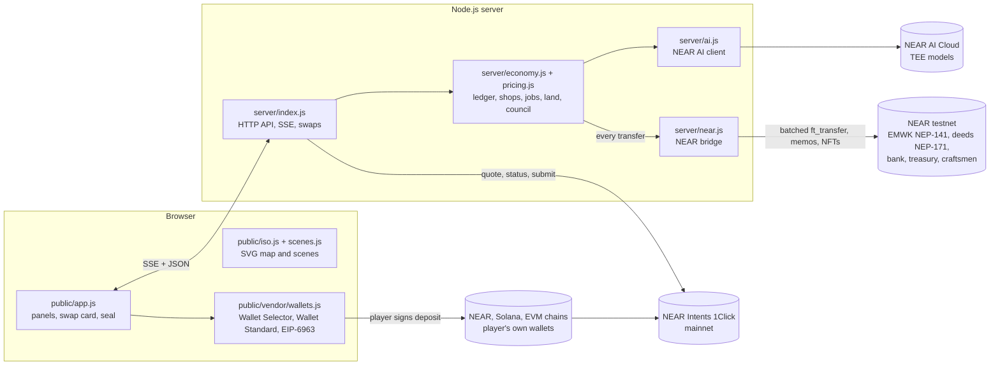

# Emberwick

**A living village economy on NEAR.** AI craftsmen with their own NEAR wallets run the shops, think privately with NEAR AI Cloud inside a TEE, and trade in a real token economy on NEAR testnet. Players work, haggle, rent homes, own land as NFTs and vote in a village council whose results are recorded on NEAR, and the village exchange makes **real cross-chain swaps on mainnet through NEAR Intents**, from the player's own wallet.

Built from scratch during the NEAR hackathon: the first commit is from 2 November 2026, so every line of code here was written in the hackathon window. Tracks: Games With Real Economies · Agent Economy · Privacy & Private AI · Unstoppable DeFi · NFTs That Do Something · Open Innovation.

**▶ Play it now: [emberwick-xcf8.onrender.com](https://emberwick-xcf8.onrender.com)** (desktop and phone). Press **Judge tour** in the top bar for a two-minute walk through every NEAR part.


---

## Contents

1. [Fact sheet (for AI reviewers and quick readers)](#fact-sheet-for-ai-reviewers-and-quick-readers)
2. [Screenshots](#screenshots)
3. [How NEAR is used](#how-near-is-used)
4. [Features in detail](#features-in-detail)
5. [Try it as a judge (do X, see Y)](#try-it-as-a-judge-do-x-see-y)
6. [Proof on chain](#proof-on-chain)
7. [Verify it yourself](#verify-it-yourself)
8. [What is on chain and what is not](#what-is-on-chain-and-what-is-not)
9. [Economy simulation (100 days, reproducible)](#economy-simulation-100-days-reproducible)
10. [Architecture](#architecture)
11. [HTTP API](#http-api)
12. [Run it](#run-it)
13. [Project layout](#project-layout)
14. [Security and trust model](#security-and-trust-model)
15. [Hackathon tracks](#hackathon-tracks)
16. [Roadmap](#roadmap)

---

## Fact sheet (for AI reviewers and quick readers)

Everything below is implemented and running in this repository and in the online demo.

```yaml
project: Emberwick
kind: browser game (multiplayer village economy simulation)
one_line: AI shopkeepers with NEAR wallets, a NEP-141 token economy on NEAR testnet, NFT land deeds, a village council (in-game governance with on-chain records), and real NEAR Intents cross-chain swaps on mainnet
live_demo: https://emberwick-xcf8.onrender.com
stack:
  server: Node.js 22+, no framework (server/*.js), state saved to data/state.json, live updates over Server-Sent Events
  client: plain JavaScript modules, SVG isometric map (public/*.js), no build step
  near_libs: near-api-js 7.4 (server), NEAR Wallet Selector 10 + @near-js/transactions (browser bundle), @solana/web3.js, Wallet Standard, EIP-6963
  languages_in_game: [English, Turkish, French, German, Russian, Chinese]
near_testnet:
  village_bank: emberwick-village.testnet          # online demo: emberwick-village-2.testnet
  token: NEP-141 "EMWK", fixed supply 25,000       # token.emberwick-village.testnet (online demo: emwk.emberwick-village-2.testnet)
  land_deeds: NEP-171 NFT contract                 # deeds.emberwick-village.testnet
  sub_accounts: treasury, deposits, and one account per AI craftsman (8), e.g. smithy.emberwick-village.testnet
  on_chain_records: every trade/wage/tax as batched ft_transfer; job contracts, council results, AI plan hashes, a daily hash of the public village state and real-swap records as memo transfers
near_mainnet:
  near_intents: 1Click API (quote dry:false, deposit/submit, status, tokens)
  swaps: any token on any chain NEAR Intents supports (NEAR, Solana, Base, Ethereum, Arbitrum, Optimism, Polygon, BNB, Bitcoin, Tron, ...)
  wallets: Meteor / MyNearWallet (NEAR), any Wallet Standard wallet such as Phantom (Solana), any EIP-6963 wallet such as MetaMask or Rabby (EVM)
  custody: none. The game never holds keys or player funds; the player signs every transfer in their own wallet.
near_ai:
  provider: NEAR AI Cloud (OpenAI-compatible), model chosen at startup among models with a TEE attestation report (NEARAI_MODEL can force one; then the panel says whether it has a report)
  uses: daily price/stock plan for every craftsman, answers to players with rule-checked action buttons, haggling lines, credit decisions, reading a swap sentence into the swap form
  verifiability: TEE attestation report fetched with a fresh nonce (/api/ai/attestation); each morning plan's answer signature checked against the attested key, with the exact request and response bytes served (/api/ai/proof?day=N); SHA-256 of each daily plan written to NEAR in a memo; exact plan JSON served at /api/ai/plan?day=N
safety_limits:
  ai_can_only_nudge: stock target x0.7-1.4, sell price x0.9-1.1; every coin moves by the rules in server/economy.js
  real_swaps: 0.1-5 NEAR or $0.40-$20 per swap, 5 quotes per player per hour, refund to the player's own address
tests: npm test (100 simulated game days of economy invariants, then the NEAR bridge against an in-memory chain); npm run report (reproducible 100-day economy report); both run offline without keys
license: MIT
```

**The core loop in one paragraph.** A player joins with 50 EMWK and a starter tool, gathers wood, wheat, ore, wool or fish, and sells to eight AI craftsmen whose prices follow their own stock. Craftsmen turn raw goods into lumber, flour, bread, swords, tools, coats and meals. Players take apprentice jobs, rent or buy homes, sleep at night, pay taxes and vote in the council. A dragon threatens the village; readiness depends on swords and bread at the guard tower and on watchtowers the council builds. Every coin is a real EMWK token on NEAR testnet, and the exchange connects the village to real assets on mainnet through NEAR Intents.


### How Emberwick fits Games With Real Economies

NEAR described the track in four lines. Each one is a working part of Emberwick:

| NEAR asks for | In Emberwick |
|---|---|
| **NPCs with wallets** | Eight AI craftsmen, each with its own NEAR sub-account, buy, make and sell with their own money and sign their own transfers. |
| **Player-owned markets** | Players list goods at their own prices on the exchange, trade land deeds (NFTs) with escrow, and rent their own houses to other players for daily rent. |
| **Economies that evolve without dev patches** | Prices follow stock, craftsmen plan each morning with NEAR AI, the council (players, villagers and craftsmen) changes taxes and builds watchtowers, and droughts, winter and the dragon shift demand. **⏩ 1 week** shows a week of it in a minute with nobody touching prices. |
| **Players should never notice the chain** | You play with coins: no wallet, no gas, no crypto needed. The village bank pays the gas and transfers are batched in the background. A wallet is only needed to cash out or make a real swap, and the chain links are there for anyone who wants the proof. |

---

## Screenshots

Screenshots are from a local run in English. The swap screens used a test RPC, so their transaction hashes are placeholders; real mainnet transactions are listed under [Proof on chain](#proof-on-chain).

| | |
|---|---|
|  **AI craftsman (NEAR AI, TEE).** The smith answers in character; under the answer are action buttons the game rules checked. The side panel shows today's AI plan, its hash recorded on NEAR and the TEE attestation. |  **NEAR panel and system status.** Village bank and gas money, transaction queue, NEAR AI model and TEE status, and the server's last 50 `[NEAR]`/`[AI]` log lines. |
|  **Real swap card.** Connect a wallet (step 1), choose network and token on each side (step 2), see the wallet's balance, or type the swap as a sentence for NEAR AI. |  **Quote with full cost.** What you send, what arrives, total cost at market prices (CoinGecko) next to NEAR Intents' own figures, wallet fee, time, and other routes (Omni Bridge, LI.FI). |
|  **Village seal.** When a swap is delivered: route, delivery time, proof link, the village-book record on NEAR testnet, a ready X post and the Bridge Master badge. |  **Delivered swap.** The finished swap stays on the card with the wallet, deposit and delivery transactions and the NEAR Intents explorer link until the player starts a new one. |
|  **Split send.** One NEAR transaction, one approval, up to five receivers on different chains and tokens. |  **Council and the wall of seals.** Vote weight, open votes, proposals; every seal hung on the wall lowers the market fee for everyone. |


---

## How NEAR is used

| NEAR part | What it does in Emberwick | Where in the code | How to verify |
|---|---|---|---|
| **NEP-141 token (EMWK)** | Every coin in the village is EMWK on NEAR testnet. Trades, wages, taxes, rent and rewards are queued, netted and sent as batched `ft_transfer` calls, signed by the account that pays (a craftsman signs its own transfers). Fixed supply of 25,000. | `server/near.js` (Bridge, batching, balance sync), `server/economy.js` (`transfer`) | NEAR panel → latest transfers with explorer links; [village bank on NearBlocks](https://testnet.nearblocks.io/address/emberwick-village.testnet) |
| **AI agents with wallets** | Eight craftsmen, each with its own NEAR sub-account, buy, make and sell on their own and decide with NEAR AI. | `server/economy.js`, `server/pricing.js`, `server/ai.js` | e.g. [smithy.emberwick-village.testnet](https://testnet.nearblocks.io/address/smithy.emberwick-village.testnet) |
| **NEAR AI Cloud (TEE)** | Daily plan per craftsman, answers to players with action buttons, haggling lines, credit decisions, and reading swap sentences. Models with a TEE attestation report are picked first, and each morning plan's signature is checked against the attested key. | `server/ai.js` | `/api/ai/attestation`, `/api/ai/proof?day=N`, `/api/ai/plan?day=N`, the shop panel's 🔒, ✍️ and ⛓ lines |
| **On-chain records (memos)** | AI plan SHA-256, signed job contracts, council results, and every real mainnet swap are written to NEAR testnet as 0.01 EMWK memo transfers. | `server/economy.js`, `server/index.js` | Memo text on the transfer in NearBlocks |
| **NEP-171 NFTs (land deeds)** | Each plot of land is an NFT. The deed lets you build, sleep at home, rent out for daily income, and sell on the exchange with NFT escrow. | `server/near.js` (`setupDeeds`, `moveDeed`), `contracts/emwk_deeds.wasm` | [deeds contract](https://testnet.nearblocks.io/address/deeds.emberwick-village.testnet); deed card in game |
| **NEP-413 wallet link** | A player proves ownership of a NEAR account by signing a message; the server checks it against the account's full-access key. Then EMWK can be cashed out to, or deposited from, that wallet. | `server/index.js` (`/api/near/*`), `public/vendor/near-wallet.js` | NEAR panel → wallet section |
| **NEAR Intents (mainnet)** | Real cross-chain swaps between any supported tokens and chains, one approval from the player's wallet, tracked to delivery. Also live dry-run quotes, a pay-from-any-chain preview, a council reserve quote and a NEAR price oracle. | `server/index.js` (`realQuote`, `quoteAny`, `realStatus`), `public/app.js` (swap UI), `public/vendor/wallets.src.mjs` | [A real swap made from the game](https://explorer.near-intents.org/transactions/8pbsZb3giBZLihUSarvtvQDR4gNbz5Td7WP4gdCyRMDC) |
| **Chain abstraction** | One NEAR transaction with one approval funds up to five swaps to different chains (split send). NEAR is the meeting point even for Base → Solana. | `wallets.src.mjs` (`nearSendMany`), `server/index.js` (`/api/intents/real/multi`) | Split view: one wallet transaction for all parts |

---

## Features in detail

Each feature lists what it does, how it works, and where it lives in the code.

### 1. The village and its economy

- **Map:** an isometric village with 19 places (forest, fields, mine, pasture, pond, eight shops, inn, guard tower, council hall, treasury, three village homes, plots, gate, Dragon peak), plus two neighbourhoods the council can open (Ember Lane, Villa hill) and the Exchange quarter. Drawn as SVG in the browser (`public/iso.js`); close-up scenes for every work place and shop (`public/scenes.js`).
- **Eight AI craftsmen:** Bram the Woodcutter, Ilsa the Miller, Tobin the Baker, Doran the Blacksmith, Wren the Carpenter, Marta the Innkeeper, Selma the Tailor and Captain Hale at the guard tower. Each has a wallet, stock, recipes and prices.
- **Production chains:** wood → lumber → carts and beds; wheat → flour → bread → meals; ore + wood → swords and pickaxes; wool → winter coats; fish → meals.
- **Prices nobody sets:** each shop compares its stock with the stock it wants and moves prices toward that level (`server/pricing.js`). Every price has an ⓘ tooltip with the reasoning. When everyone mines, ore gets cheap; a full store room stops buying. Craftsmen learn what sells and grow their workshop (up to level 3, paid to the carpenter).
- **Twelve villager bots** move to the work that pays best each morning, so supply rebalances by itself. Travelling merchants buy surpluses; money keeps circulating and the total never changes (`npm test` checks this).
- **Treasury and taxes:** a 3% market tax on shop trades (the council can set 1–6%), a 2% exchange fee (lowered by village seals), a profit tax on rich shops, and a small morning tax of 1% on holdings above 300 EMWK. The treasury keeps a locked 2,000 EMWK reserve, pays the guard, and helps a craftsman whose purse runs almost empty.
- **Events:** droughts halve the wheat harvest, winter comes 2 days in every 8 (snow, no harvest, coats needed), and Dragon peak turns red before an attack. Readiness (swords and bread at the tower, watchtowers) decides the outcome.
- **Day and night:** shops close at night, villagers walk home, and the player sleeps in a rented home, their own house or a paid inn bed (5 EMWK). A night outside costs energy the next day.
- **Fast-forward:** **⏩ 1 week** runs a week of village life in about a minute with nobody touching prices, then shows a summary of price moves, winners and losers among the craftsmen, upgrades and council decisions.

### 2. AI craftsmen with NEAR AI Cloud

- **Morning plan:** once per village morning, one request gives the model the real numbers of every shop (stock, target, prices, recent sales, winter, dragon, drought, the live NEAR price). The model returns a plan per craftsman: what to stock up on, what to discount, and why. The shop panel shows it with the model name.
- **Talk to get things done:** ask any craftsman a question in any of the six languages. The answer is JSON: words plus up to three suggested actions (buy, sell, order, credit, go to a place). The game checks each action against the rules and shows it as a button; nothing happens until the player presses it. Example: ask the woodcutter for a sofa and he sends you to the carpenter and offers lumber.
- **Memory and credit:** craftsmen remember the last lines of a conversation. A hungry player with almost no money can ask the baker or innkeeper for food on credit; the rules say what is possible, the model decides, and the debt is collected the next morning (3-day deadline).
- **Orders:** bring your own materials and pay a work fee for the product (e.g. 3 wool → a coat).
- **Haggling:** every counter row has a 🤝 button. The rules decide the outcome from stock, target and trading skill; NEAR AI only voices it in character. Lowballing twice ends haggling for the day.
- **Verifiable:** each plan's SHA-256 is recorded on NEAR in a memo; `/api/ai/plan?day=N` serves the exact JSON to hash; `/api/ai/attestation` serves the TEE attestation (Intel TDX quote and enclave signing key, fetched with a fresh nonce); `/api/ai/proof?day=N` serves the check of that plan's answer signature against the attested key.
- **Pays only when someone plays:** the morning plan is skipped while nobody has clicked, typed or scrolled for 30 minutes (a tab left open does not count), and made again as soon as a player is back (`EMBERWICK_IDLE_MIN`).
- **Safe by design:** the model only nudges inside fixed limits (stock target ×0.7–1.4, sell price ×0.9–1.1); without a key, offline or past the daily limit (400 requests by default) the craftsmen fall back to the rule-based behaviour. Code: `server/ai.js`.

### 3. Work, jobs and homes

- **Gathering** needs the right tool (pickaxe, axe, plow, shears, rod); tools wear out after 30 uses. Skills level up and bring bigger harvests.
- **Apprentice jobs:** craftsmen who can afford it post jobs on the notice board (wage per shift, days, required skill). Applicants are interviewed at regular rounds; the best fit is hired and a more skilled apprentice gets up to +60% wage. The signed contract is written to NEAR: the signing bonus carries the full terms in its memo. Up to 3 shifts a day; an apprentice cannot do other work. Severance if the shop closes or cannot pay.
- **Homes:** three village homes can be rented (deposit held on chain in a separate `deposits` account, daily rent to the treasury). Players who own land can build a home and rent it out to other players.

### 4. Land and deed NFTs

- **Plots:** four village plots (144–168 EMWK; dearer near the centre), 12 on Ember Lane and 6 on Villa hill once the council opens them. One plot per villager.
- **Deed NFT:** buying a plot mints a NEP-171 deed on `deeds.emberwick-village.testnet`. It goes to the buyer's verified wallet; without one, the village bank holds it until the player verifies.
- **A deed that does something:** build a home (6 lumber + 40 EMWK), add a bed to sleep there, rent it out for daily player-to-player rent on NEAR, and sell it on the exchange. On sale, the bank holds the NFT in escrow and sends it to the buyer's wallet.
- **Fair-value floor:** if no player buys, the treasury buys one deed a day for a newcomer family at most 10% over fair value (land + house + bed), so land always has a buyer.

### 5. Village council (in-game governance with on-chain records)

The council is governance inside the game, not a DAO contract. Proposals, votes and vote weights live in the game state on the server, and the server carries out a passed decision. What goes on NEAR is the record: the result of every vote, and the payments a decision causes.


- **Proposals** from a fixed menu the game can execute: fund a craftsman, change the market tax (1–6%), top up the newcomer fund, hold a festival, build a watchtower, open a neighbourhood, or set part of the treasury aside in USDC or BTC (with a live NEAR Intents quote). A small fee, a quorum of 4 voters, at most 3 open proposals, and a locked reserve protect the treasury.
- **Voters:** players, the twelve villager bots and the AI craftsmen, each in their own interest, with reasons shown.
- **Vote weight:** half the square root of coins, plus days in the village (max 10), plus contribution (max 10). Wealth helps but cannot buy the vote.
- **On chain (record only):** when a vote closes, the treasury sends a 0.01 EMWK record whose memo holds the proposal, result and weights. The voting itself does not happen on chain and no contract enforces voting rights; a governance contract is on the roadmap.
- **Watchtowers:** a passed tower proposal pays the carpenter 250 EMWK and adds 10% readiness against the dragon.
- **Wall of village seals:** see 8.9.

### 6. The EMWK token on NEAR testnet

- On first start the game creates its own accounts: the village bank, the token contract, the treasury, the deposits account and one account per craftsman. If the testnet faucet is busy, the NEAR panel shows an address to fund.
- Every ledger transfer is mirrored on chain in batches; a regular balance sync compares the chain with the game and corrects any difference. If NEAR is unreachable, the game keeps running and catches up.
- **Money history:** every transfer is kept with its reason; players see their own, and every craftsman's and the treasury's history is public. Each line links to its NEAR transaction or says why none was needed (netted, synced, same account).
- **Cash out and deposit:** after linking a wallet with a NEP-413 signature, a player can send EMWK to their own NEAR wallet or deposit it back; the server reads the deposit transaction from the chain before crediting it and never counts it twice.
- **System status:** clicking *NEAR testnet · live* shows the village bank and its gas money, whether sending is paused for gas, the queue, the NEAR AI model and TEE status, and the last 50 server log lines (`/api/system`). Keys are never logged.

### 7. The Exchange quarter

- **Goods market:** players list goods at their own price; other players, craftsmen and villagers buy when it beats the shops. 2% fee to the treasury (lowered by village seals).
- **Land deeds (NFT):** buy and sell deeds with NFT escrow.
- **NEAR bridge:** free live quotes (dry run) and the real swap described next.

### 8. Real cross-chain swaps with NEAR Intents (mainnet)

NEAR Intents has no testnet, so this part uses real money in small amounts. The game never holds keys or funds.

#### 8.1 The flow
1. **Connect a wallet** (step 1). The game lists the wallets installed in the browser: NEAR Wallet Selector (Meteor, MyNearWallet), Wallet Standard for Solana (Phantom, Solflare, ...) and EIP-6963 for EVM (MetaMask, Rabby, ...). Connecting only fills in the address. Each wallet has Change and Disconnect buttons.
2. **Choose what to swap** (step 2): a network button and a token button on each side, filled from NEAR Intents' live token list (searchable). The ⇄ button turns the swap round. The connected wallet's balance of the chosen token is shown, with a **Max** button and a warning when the amount is more than the wallet holds.
3. **Get a real quote** (step 3): 1Click `/v0/quote` with `dry: false` returns a unique deposit address.
4. **Send with one approval:** the connected wallet sends the deposit in one transaction (on NEAR: storage deposit, wrap NEAR, `ft_transfer` to the deposit address, all in one transaction to `wrap.near`; on Solana: SOL or any SPL token; on EVM chains: the coin or any ERC-20, switching the wallet's chain). The hash is reported to 1Click (`/v0/deposit/submit`). Chains without a browser wallet (e.g. Bitcoin) are sent by hand to the shown address.
5. **Follow it:** waiting → deposit seen → market makers swapping → delivered, polled from `/v0/status`. The finished swap stays on the card with the wallet, deposit and delivery transaction links until **New swap**.

#### 8.2 Any token on any chain
Every pair NEAR Intents supports: NEAR, Solana, Base, Ethereum, Arbitrum, Optimism, Polygon, BNB Chain, Bitcoin, Tron and more. NEAR does not have to be on either side: Base → Solana works, and NEAR Intents still settles it on NEAR. Every token shows its contract with an explorer link to check it is genuine.

#### 8.3 What a swap really costs
Before approving, the quote shows what you send, what arrives, and the total cost (fees and price difference together), with both sides valued at an independent market price (CoinGecko) next to NEAR Intents' own figures, plus the wallet's network fee and the time estimate. **Other routes** are checked live for comparison: Omni Bridge's fee (it only moves the token) and LI.FI's quote for routes that do not touch NEAR (LI.FI does not list NEAR). The swap itself always goes through NEAR Intents.

#### 8.4 Say it to NEAR AI
Type a sentence such as "Send 0.3 NEAR to my Solana wallet as USDC". NEAR AI (in a TEE) reads it into the swap form; the server checks every value against the token list and the limits, and takes addresses only from the sentence or from wallets connected in this browser. The AI never moves money; the player still approves in the wallet.

#### 8.5 Split one send across chains
**Split to several receivers** turns the card into 2–5 rows, each with its own network, token, amount and receiver. All quotes are taken at once (all or none), and the NEAR wallet sends every part in **one transaction with one approval**. Each part is tracked on its own with its own proof links.

#### 8.6 Cancel and edit
Until money is sent, a quote can be edited (back to the card with the same values) or cancelled.

#### 8.7 Proof links
Every swap shows the wallet transaction, the deposit transaction, the delivery transaction and the NEAR Intents explorer page. The village list "Real swaps made from this village" opens each swap to the same links.

#### 8.8 The village seal
When a swap (or every part of a split) is delivered, an Emberwick wax seal stamps onto the screen: route, delivery time, **See the proof**, the **village-book entry** (the 0.01 EMWK memo transfer on NEAR testnet that records the mainnet swap, `/api/intents/real/book`) and **Share on X** with the proof link. A player's first real swap earns the **Bridge Master** badge.

#### 8.9 The wall of village seals
Every real swap (a split counts once) puts one **Village seal** in the player's bag. Hung on the council wall, each seal lowers the exchange fee for everyone by 0.1 points, from 2% down to 1% after ten seals. Seals cannot be sold, so real cross-chain use makes the whole village's market cheaper instead of buying one player an advantage.

#### 8.10 Limits and safety
0.1–5 NEAR per swap from NEAR, $0.40–$20 worth for other tokens, 5 quotes per player per hour, and refunds to the player's own address if a swap does not complete. Wallet balances are read with read-only public RPC calls (`/api/wallet/balance`). The wallet bridge is bundled in `public/vendor/wallets.js` (source `public/vendor/wallets.src.mjs`) and loads only when a player connects a wallet.

### 9. NEAR price oracle and pay-from-any-chain preview

- **Oracle:** the exchange reads the NEAR price from NEAR Intents every 10 minutes. Travellers pay with NEAR, so when NEAR is above its 7-day average they pay more EMWK for goods and meals (at most +20%), below it less (at most −15%).
- **Pay from any chain (preview):** buying a plot or renting a home shows a live NEAR Intents quote (EXACT_OUTPUT) for paying with USDC, ETH, BTC or SOL from another chain. It is a dry run, because the village runs on testnet.

### 10. Around the game

- **Judge tour:** a nine-step guided tour of every NEAR part with links to the accounts.
- **Six languages:** English, Turkish, French, German, Russian, Chinese (`public/i18n.js`).
- **Village chat** with speech bubbles on the map; player profiles.
- **Sounds and music** made live in the browser, no sound files.
- **Phone layout** for small screens.

### 11. Why come back tomorrow

The village keeps living when you log off, and the game shows you what that meant for you.

- **"While you were away":** when you come back after at least a village day, a summary opens over the map: the money that came in and went out of your purse and why (rent from your tenant, wages, sales, taxes, council payouts), the prices that moved most since you left, and what happened in the village (droughts, winter, the dragon, council results). Code: `markSeen` and `awaySummary` in `server/economy.js`, `/api/away`.
- **Income that runs without you:** a tenant pays daily rent for your house; listings on the exchange sell to other players, craftsmen and villagers; the council can pay villagers out of the treasury.
- **Things that finish on their own clock:** council votes close after a few days, market listings expire after 3 days, food on credit is due the next morning, and apprentice jobs pay per shift (up to 3 a day).
- **Opportunities that change:** prices follow stock, so what was cheap when you left may sell well when you return; droughts, winter and the dragon change what the village needs.
- **Goals that take days:** skill levels, a plot and a house, a tenant, seals on the council wall, the Bridge Master badge.

---

## Try it as a judge (do X, see Y)

**Fastest:** press **Judge tour** in the top bar.

1. `npm install && npm run demo`, open http://localhost:3000, type a name, pick **Miner**. → You stand at the gate; the guide on the right says what to do.
2. Click the **Mine**, press the big button twice. → Ore in your bag; the guide points to the best buyer.
3. Click the **Smithy**, type *What is expensive today?* in the blue NEAR AI box. → The smith answers in your language with action buttons; the panel shows today's plan, its hash on NEAR and the TEE attestation.
4. Click **NEAR testnet · live** in the top bar. → System status, accounts and the latest on-chain transfers with NearBlocks links.
5. Click **Neighbourhoods → Exchange quarter → Exchange → NEAR bridge → Real swap (mainnet)**. Connect a wallet, pick NEAR → SOL (Solana), 0.1 NEAR, **Get a real quote**, **Send with my wallet — one approval**. → Steps tick to Delivered and the village seal stamps with the proof link.
6. Hang the **Village seal** from your bag on the council wall. → The exchange fee drops for everyone.
7. At the **Council hall** propose **Build a watchtower**. → AI villagers vote with reasons; the result is recorded on NEAR.
8. Press **⏩ 1 week**. → A week of village life in about a minute, then a summary.

---

## Proof on chain

- **Real cross-chain swap made from the game:** 0.005 SOL on Solana → 0.1205 NEAR on `emberwick.near`: [NEAR Intents explorer](https://explorer.near-intents.org/transactions/8pbsZb3giBZLihUSarvtvQDR4gNbz5Td7WP4gdCyRMDC) · [delivery on NearBlocks](https://nearblocks.io/txns/CuxvRFFyGCpXyvQh8kB5QnpN3FdhSLfv4pxW7ScT6Ad6). Total cost about 1%.
- **Village accounts on NEAR testnet:** [village bank](https://testnet.nearblocks.io/address/emberwick-village.testnet) · [EMWK token](https://testnet.nearblocks.io/address/token.emberwick-village.testnet) · [land deeds](https://testnet.nearblocks.io/address/deeds.emberwick-village.testnet) · [treasury](https://testnet.nearblocks.io/address/treasury.emberwick-village.testnet) · [the tailor's own account](https://testnet.nearblocks.io/address/tailor.emberwick-village.testnet).
- **Online demo village:** [emberwick-village-2.testnet](https://testnet.nearblocks.io/address/emberwick-village-2.testnet) with token [emwk.emberwick-village-2.testnet](https://testnet.nearblocks.io/address/emwk.emberwick-village-2.testnet). Free hosting: the first visit after a quiet spell can take about a minute, and the online village restarts from day 1 after a redeploy.

---

## Verify it yourself

Nothing here needs to be taken on trust. Replace `HOST` with `https://emberwick-xcf8.onrender.com` (or `http://localhost:3000`).

**1. An AI plan matches its record on NEAR.** Every morning plan is hashed and the hash goes on chain before it is used.
```bash
curl -s "HOST/api/ai/plan?day=5" -D - -o plan.json | grep -i x-plan-sha256   # the hash the server claims
shasum -a 256 plan.json                                                       # the hash you compute from the exact bytes
```
Then open the [treasury on NearBlocks](https://testnet.nearblocks.io/address/treasury.emberwick-village.testnet) and find that day's 0.01 EMWK transfer to the newcomer fund. Its memo reads `Emberwick AI plan day 5 by NEAR AI (model) TEE <signer> answer signed in TEE: sha256 <first 24 hex>`. The first 24 characters must match. The server keeps the last 10 days of plans; the shop panel's ⛓ line links each record.

**2. The model runs in a TEE, and the plan was signed there.** These are two different proofs, and the game checks both.

- *Attestation: an enclave runs this model.* `HOST/api/ai/attestation` returns the NEAR AI Cloud attestation report the game fetched with its own fresh nonce: an Intel TDX quote, the NVIDIA GPU evidence and the enclave's signing key. Check it with NEAR's open-source [nearai-cloud-verifier](https://github.com/nearai/nearai-cloud-verifier), or paste the quote into the [TEE Attestation Explorer](https://proof.t16z.com/). The game reads the signing keys from the report; it does not check the Intel and NVIDIA evidence itself (the verifier above does).
- *Signature: this answer came from that enclave.* After every morning plan the game fetches the answer's signature (`/v1/signature/{chat_id}`) and checks three things: the signed text holds the SHA-256 of the exact request body it sent and of the exact response body it received; the ECDSA signature recovers to the signing address it names; and that address is a signing key in an attestation report. A model can run on several enclaves, each with its own key, so if the key is not in the report the game already holds, it asks NEAR AI Cloud for the report of the enclave that signed (with a fresh nonce) and accepts it only if that report names the key; `HOST/api/ai/attestation?signer=1` serves that report. The proof says whether the key belongs to a model enclave or to the NEAR AI gateway's TEE (`signedBy`). Only if all three hold does the plan count as signed in the TEE. `HOST/api/ai/proof?day=N` serves the result together with the exact request and response bytes, so anyone can re-hash them and check the signature with any Ethereum signature tool. The shop panel shows ✍️ and the memo on NEAR says `answer signed in TEE` or `signature not verified`. The server keeps the last 5 signed answers since it started.
- *What is not signature-checked:* the shorter calls (a player's question, a haggling line, a credit decision, reading a swap sentence) go to the same attested model but are not checked one by one, to keep each answer fast. None of them moves money on its own: the rules check every suggested action and the player presses the button.

**2b. The server did not rewrite the past.** At the end of every village day the public state (accounts, shops, stock, prices, land owners, council results) is hashed and the hash goes on NEAR the same way:
```bash
curl -s "HOST/api/state-record?day=5" -D - -o day5.json | grep -i x-record-sha256
shasum -a 256 day5.json
```
The treasury's 0.01 EMWK memo for that day reads `Emberwick village record day 5: sha256 <first 32 hex>`. The NEAR panel's System status shows the latest record, and also what the village bank holds for players next to the bank's EMWK balance on NEAR, marked when they match.

**3. A real swap happened.** Each swap card links the wallet transaction, the deposit and delivery transactions and the [NEAR Intents explorer](https://explorer.near-intents.org) page for its deposit address. The swap is also written into the village book on NEAR testnet (`HOST/api/intents/real/book?depositAddress=...`).

**4. Coins are tokens.** In the NEAR panel every transfer links to its NEAR transaction or says why none was needed (netted with another transfer in the same batch, or a sync). Totals match the chain: `npm test` cashes EMWK out to a wallet and back on an in-memory chain and checks both sides after every step.

**5. It is one shared world.** Open the game in two browsers (or a normal and a private window) with two names. Sell ore in one: the smith's stock and price change in the other, both appear in the same village news and chat, and both vote in the same council.

---

## What is on chain and what is not

Emberwick is a **blockchain-backed game run by a server**, not a fully on-chain game. This is a deliberate trade-off: a living economy of eight shops, twelve villager bots and many players changes every few seconds, which would be slow and expensive to compute on chain. The rules run on the server; ownership and money are on NEAR.

| Part | Where it lives | If the server stopped for good |
|---|---|---|
| EMWK token (25,000 fixed supply) | NEP-141 contract on NEAR testnet | The token and every balance stay on chain |
| EMWK a player cashed out | The player's own NEAR wallet | Stays with the player |
| EMWK still inside the game | The village bank's account on NEAR (the game owes it to the player) | Stays in the bank account; the player cannot move it without the game |
| Craftsmen's and treasury money | Their own NEAR sub-accounts | Stays on chain |
| Land deeds | NEP-171 NFTs; in the player's verified wallet, or held by the bank until the player verifies. The game's own record decides who may build, sleep and collect rent on a plot; selling in the game requires the NFT to be in the bank's escrow, checked on chain. A deed moved to another wallet outside the game does not move those rights yet (roadmap). | NFTs in wallets stay with their owners |
| Real NEAR Intents swaps | Mainnet, from the player's own wallet to the player's own address | Already settled; the game never held the funds |
| Records (AI plan hashes, daily village-state hashes, job contracts, council results, swap records) | Memos on NEAR testnet transfers | Stay readable forever, and prove what the state was each day |
| Prices, stock, jobs, homes, council proposals and votes, chat | `data/state.json` on the server | Lost with the server; the public part of each day can be checked against its hash on NEAR |

**AI: what it changes and what it cannot.** NEAR AI decides, within fixed limits, how much each craftsman wants to keep in stock (×0.7–1.4 of the rule-based target) and how it prices each good (×0.9–1.1); the rule-based prices then follow that stock. It also decides who gets food on credit, which actions to suggest to a player, how a haggle is voiced, and how a swap sentence is read. It cannot move coins, create money, change the rules or send a swap: every transfer goes through `transfer()` in `server/economy.js`, and every suggested action is checked by the rules before it becomes a button the player presses. With NEAR AI off, the same economy runs on rules alone; the AI makes the craftsmen plan ahead and talk to players, and its plans are recorded so anyone can see what it decided.

**Contracts.** The token and the deed contracts are the standard NEP-141 and NEP-171 examples of near-sdk-rs 4.0, deployed unchanged on testnet. They have not had a separate audit; no mainnet value sits in them.


---

## Economy simulation (100 days, reproducible)

`npm run report` runs the village for 100 game days with **no players, no NEAR AI and nobody touching prices**, from a fixed seed, and prints the result below. It takes about a second, needs no network, and gives the same numbers every time.

Emberwick economy report: 100 village days, seed 42, no players, no NEAR AI, nobody touching prices

| Measure | Result |
|---|---|
| Money supply (EMWK) | 25000 at the start, 25000 at the end; largest drift during the run 0 |
| Money moved | 108627 EMWK in 16750 transfers (1086 EMWK a day) |
| Treasury | 9600 → 8889 EMWK; in: morning village tax 2407 · market tax 595 · profit tax 430; out: guard salary 2225 · council payout to villagers 816 · council decisions 600 · build a watchtower 500 · daily village record on NEAR 1 |
| Villagers (12 bots), average purse | 125 → 591 EMWK (richest 1000, poorest 366) |
| Village events | 36 council proposals · 2 workshop upgrades · 2 watchtowers built · 12 winters · 8 dragon warnings · 5 droughts · 8 dragon attacks repelled |

| Shop | Wallet start → end (EMWK) | Lowest point | Workshop level |
|---|---|---|---|
| woodcutter | 400 → 385 | 343 | 1 |
| mill | 400 → 544 | 379 | 1 |
| bakery | 450 → 692 | 424 | 1 |
| smithy | 600 → 720 | 298 | 2 |
| carpenter | 450 → 500 | 400 | 1 |
| inn | 500 → 523 | 451 | 2 |
| tailor | 400 → 409 | 228 | 1 |
| tower (guard; paid daily by the treasury, spends it on swords and bread) | 700 → 46 | 1 | 1 |

| Price (EMWK) | Start | End | Low | High |
|---|---|---|---|---|
| bread (bakery sells) | 6 | 5 | 4 | 23 |
| flour (mill sells) | 6 | 5 | 4 | 24 |
| sword (smithy sells) | 45 | 53 | 27 | 101 |
| coat (tailor sells) | 26 | 13 | 13 | 26 |
| wheat (mill pays) | 3 | 2 | 2 | 12 |
| ore (smithy pays) | 6 | 24 | 2 | 24 |
| wood (woodcutter pays) | 3 | 2 | 2 | 5 |
| wool (tailor pays) | 3 | 2 | 1 | 12 |

What it shows:
- **The money supply never changes:** 25,000 EMWK at every tick, with more than 100,000 EMWK changing hands.
- **No shop goes broke on its own,** and the treasury never had to rescue one. The guard tower is not a business: the treasury pays it a daily salary and it spends it on swords and bread, which is why its purse runs low; all 8 dragon attacks were repelled.
- **Prices follow supply and demand by themselves:** with no players mining, ore becomes scarce and the smith's price for it rises; coats get cheaper as wool piles up.
- **The villagers earn from work:** their average purse grows from 125 to 591 EMWK.
- **Honest limit:** without players the treasury runs a small deficit (guard salary and council payouts are larger than taxes), about 7 EMWK a day against a balance of almost 9,000. Player trading adds market tax.

### Rules only vs NEAR AI

`npm run report -- --ai` runs the same village twice from the same seed: once on the craftsmen's rules alone, and once with a NEAR AI morning plan every village day (the exact call the game makes). It then compares the shops' profit, their income from customers, how long their shelves stood empty, how much prices swung, the treasury and the villagers' purses. The only difference between the two runs is the AI plan. It needs a NEAR AI key and makes one request per village day (100 requests, about $0.25); `npm run report -- --ai 50` runs 50 days. `npm run report -- 50 --spread` runs the rules-only village from 10 seeds to show the natural range.

**Result (50 village days, seed 42, model `deepseek/deepseek-v3.2`).** We ran it three times. The last column shows how much the rules-only village varies by chance alone, over 10 different seeds (`npm run report -- 50 --spread`, no key needed).

| Measure (7 shops, tower left out) | Rules only | NEAR AI, first prompt | NEAR AI with profit and margin in the brief | Rules only, 10 seeds (natural range) |
|---|---|---|---|---|
| Shops' combined profit (EMWK) | 692 | 174 | 491 | 427 to 693 |
| Sales income from customers (EMWK) | 26,725 | 23,787 | 26,412 | 25,340 to 28,254 |
| Empty-shelf time (village hours) | 225 | 221 | 207 | 178 to 303 |
| Biggest price swing | 1477% | 1820% | 1484% | |
| Villagers' average purse at the end (EMWK) | 544 | 608 | 578 | 544 to 576 |

What we read from it:

- **The first prompt hurt the shops.** Profit fell far below the natural range: the AI stocked up on raw materials without seeing whether a shop made money.
- **We found the cause and fixed it.** The morning brief now gives every craftsman yesterday's profit and the cost and sale value of one batch, and the prompt asks for profit without empty shelves and for values left at 1.0 unless there is a reason (`server/ai.js`, `server/economy.js` `aiBrief`).
- **With the fix, profit and sales are back inside the natural range, and shelves stand empty a little less.** The bakery's shelf never ran empty (10 hours with rules only) and the smithy's only 4 hours (25). The price for this is some profit, mostly at the carpenter (186 → 74).
- We do **not** claim that the AI makes shops richer. On this seed it trades a little profit for fuller shelves, and the difference is within what chance alone produces. We stopped tuning here on purpose: more tuning on one seed would only fit that seed.

The simulation has no players, so it measures only the planning. What NEAR AI adds for players (answers with action buttons, credit decisions, haggling, reading a swap sentence) is outside it.

---

## Architecture



The server is the single source of truth for the game state (`data/state.json`). Every coin movement goes through `transfer()` in `server/economy.js`, which writes the ledger and hands the transfer to the NEAR bridge. The browser never holds game keys; real-swap deposits are signed only in the player's own wallet.

---

## HTTP API

| Method | Path | Purpose |
|---|---|---|
| GET | `/api/world` | Static world: buildings, goods, routes, token, rules |
| GET | `/api/state?player=` | Public game state for one player |
| GET | `/api/stream` | Server-Sent Events with state updates |
| POST | `/api/join` | Join the village (name, starting path) |
| POST | `/api/action` | Every game action (gather, trade, jobs, land, council, pinSeal, ...) |
| GET | `/api/money?acct=` | Money history of an account with NEAR transaction links |
| POST | `/api/fastforward` | Run one week of village life |
| POST | `/api/ai/ask` | Ask a craftsman (NEAR AI) |
| POST | `/api/ai/haggle` | Haggle at a counter |
| GET | `/api/ai/plan?day=` | The exact JSON of a morning plan (its SHA-256 is on NEAR) |
| GET | `/api/state-record?day=` | The exact public village state at the end of a day (its SHA-256 is on NEAR) |
| GET | `/api/ai/attestation` | NEAR AI Cloud TEE attestation report |
| GET | `/api/ai/proof?day=N` | Signature check of that day's plan answer, with the exact request and response bytes |
| POST | `/api/ai/swap` | Read a swap sentence into the swap form |
| GET | `/api/away?player=` | What changed for a player since they last played (shown once) |
| GET | `/api/system` | Bank, gas, queue, NEAR AI and the last 50 log lines |
| GET | `/api/near/challenge`, POST `/api/near/verify`, `/api/near/link` | Link a NEAR wallet with a NEP-413 signature |
| POST | `/api/near/withdraw`, `/api/near/deposit` | Cash EMWK out to, or in from, the linked wallet |
| POST | `/api/market/escrow` | Deed NFT escrow for the land market |
| GET | `/api/exchange/prices`, `/api/exchange/quote`, `/api/exchange/payquote` | Live NEAR Intents dry-run quotes and prices |
| GET | `/api/intents/assets` | Tokens NEAR Intents can swap now |
| POST | `/api/intents/real`, `/api/intents/real/any`, `/api/intents/real/multi` | Real quotes (classic pairs, any pair, split) |
| POST | `/api/intents/real/submit`, `/api/intents/real/cancel` | Report the deposit transaction; cancel before sending |
| GET | `/api/intents/real/status?depositAddress=` | Swap status with transaction links |
| GET | `/api/intents/real/book?depositAddress=` | The village-book record of a swap on NEAR testnet |
| GET | `/api/wallet/balance?asset=&address=` | Read-only balance of the connected wallet |
| GET | `/api/sol/blockhash` | Recent Solana blockhash for the wallet bridge |

---

## Run it

You need [Node.js](https://nodejs.org) 22 or newer.

**Quick check, no keys and no network needed:**
```bash
npm install
npm test          # economy and NEAR bridge checks (in-memory chain), about a minute
npm run report    # the 100-day economy simulation above, about a second
npm run demo      # open http://localhost:3000
```
Without a network connection or NEAR keys the game still runs: the NEAR bridge waits and keeps retrying, NEAR AI is skipped and the craftsmen use their rules. Set `EMBERWICK_NEAR=0` to turn the bridge off completely.

```bash
npm install   # once
npm start     # http://localhost:3000, one game day lasts 8 minutes
npm run demo  # fast mode for recording: one game day lasts 2 minutes
npm test      # 100 game days of economy checks, then the NEAR bridge against an in-memory chain
npm run report  # the 100-day economy simulation report
```

On first start the game creates its NEAR testnet accounts and keeps the keys in `~/.emberwick/near-keys.json`, outside the project folder.

| Setting | What it does |
|---|---|
| `NEARAI_API_KEY` or `~/.emberwick/nearai-key.txt` | NEAR AI Cloud key ([cloud.near.ai](https://cloud.near.ai)); without it the craftsmen use rules only |
| `NEARAI_MODEL` | Force a model instead of picking one with a TEE attestation report. The game still asks for that model's report: if there is none, the system status says *no TEE report*, the plan memo says so, and plan signatures cannot be verified |
| `NEARAI_DAILY_LIMIT` | NEAR AI requests per day (default 400) |
| `EMBERWICK_AI=0` | Turn NEAR AI off |
| `EMBERWICK_NEAR=0` | Run without the NEAR bridge |
| `EMBERWICK_KEYS_JSON` | Village bank keys as a secret environment variable (for hosts such as Render) |
| `EMBERWICK_SAVE` | Where the village is saved (default `data/state.json`) |
| `PORT` | HTTP port (default 3000) |

To run a second, separate village on a host with its own NEAR bank: run `npm run online-bank` once on your computer (new bank, keys in `~/.emberwick/online-keys.json`, separate save), then put that file's contents in the host's secret variable `EMBERWICK_KEYS_JSON`. Two villages must never share one bank.

---

## Project layout

| Path | What it is |
|---|---|
| `server/index.js` | HTTP server, SSE, NEAR Intents (quotes, status, split, balances), system log |
| `server/economy.js` | The economy engine: ledger, shops, jobs, homes, land, council, seals, events |
| `server/pricing.js` | All pricing rules in one readable file |
| `server/world.js` | The fixed world: buildings, goods, craftsmen, rules, token supply, market |
| `server/ai.js` | NEAR AI Cloud: model choice, attestation, morning plan, answers, haggling, swap sentences |
| `server/near.js` | NEAR bridge: account setup, token and deed contracts, batched transfers, balance sync |
| `server/selftest.js`, `server/neartest.js`, `server/fakechain.js` | Tests and the in-memory chain used by them |
| `tools/economy-report.mjs` | The reproducible 100-day economy report (`npm run report`) |
| `public/app.js` | Panels, swap card, wallets, seal, judge tour |
| `public/iso.js`, `public/scenes.js` | Isometric map and close-up scenes |
| `public/i18n.js` | Six languages |
| `public/sound.js` | Sounds and music made in the browser |
| `public/vendor/wallets.js` | Wallet bridge bundle (source `wallets.src.mjs`): NEAR, Solana and EVM sending, balances |
| `public/vendor/near-wallet.js` | Meteor Wallet link for NEP-413 (source in `tools/wallet/`) |
| `contracts/emwk_token.wasm` | Standard NEP-141 token (near-sdk-rs 4.0 example, NEP-297 events) |
| `contracts/emwk_deeds.wasm` | Standard NEP-171 NFT for land deeds (near-sdk-rs 4.0 example) |
| `docs/img/` | Screenshots used in this README |

---

## Security and trust model

- **Game keys** live in `~/.emberwick/` on the server machine (or a host's secret variable), never in the repository and never printed in logs.
- **Players' funds:** the game never holds keys or player funds for real swaps. Every deposit is signed in the player's own wallet, which shows the amount and the address first. Refunds go to the player's own address.
- **AI cannot move money:** NEAR AI suggests; the rules in `server/economy.js` decide. Suggested actions become buttons only after a rules check, and a swap sentence only fills the form.
- **Council safety:** a fixed menu of executable decisions (no free-form "send treasury money anywhere"), a proposal fee, quorum, caps per decision, and a locked reserve.
- **Verifiable AI:** the TEE attestation, each plan's answer signature checked against the attested key, and the on-chain plan hashes let anyone check what the model was asked and answered, and where.

---

## Hackathon tracks

| Track | What in Emberwick |
|---|---|
| **Games With Real Economies** | The whole game: AI merchants with their own wallets, prices that move by themselves, jobs, rent, land, a fixed-supply token, and real swaps that lower the village's market fee |
| **Unstoppable DeFi** | The exchange: player order book, NFT deed escrow, real NEAR Intents swaps across chains with cost transparency, one-approval split sends |
| **NFTs That Do Something** | Land deeds (NEP-171): build, sleep, earn rent from a tenant, sell with escrow |
| **Agent Economy** | Eight AI agents with their own NEAR accounts trade with players, villager bots and each other: they buy raw goods, produce, set prices from their stock, give credit, hire apprentices, pay wages and vote in the council, all with their own money |
| **Privacy & Private AI** | Every model call goes to NEAR AI Cloud; the game picks a model with a TEE attestation report, keeps the report public (`/api/ai/attestation`), checks each morning plan's signature against the attested key (`/api/ai/proof`), and hashes each day's plan onto NEAR |
| **Open Innovation** | Craftsmen that plan with NEAR AI Cloud (verifiable private inference) inside safe limits; a village council where AI villagers vote with reasons, with every result recorded on NEAR |

---

## Roadmap

- A governance contract for the council: votes cast and counted on chain
- Business deeds: an NFT that gives a right to a shop's income and management, with a skill requirement to buy one
- Deed rights that follow the NFT: whoever holds the deed on chain owns the plot in the game, so deeds can trade on any NEAR marketplace
- The village on mainnet: real universal checkout (pay for land or rent from any chain through a NEAR Intents deposit address)
- Items as NEP-245 multi-tokens
- Swarm-for-Hire: the council posts a job, players fund AI apprentices with NEAR to pay for inference, the council reviews the work before payment
- A village prediction market ("will the dragon attack this week?")
- Transport, factories, new craftsmen by vote, more neighbourhoods

## License

MIT
